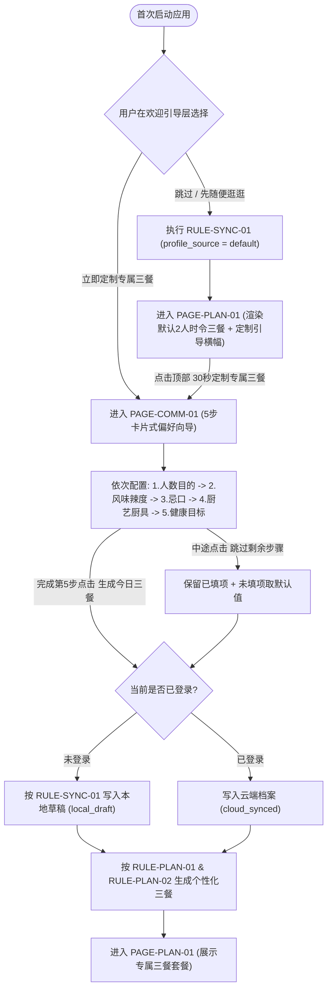
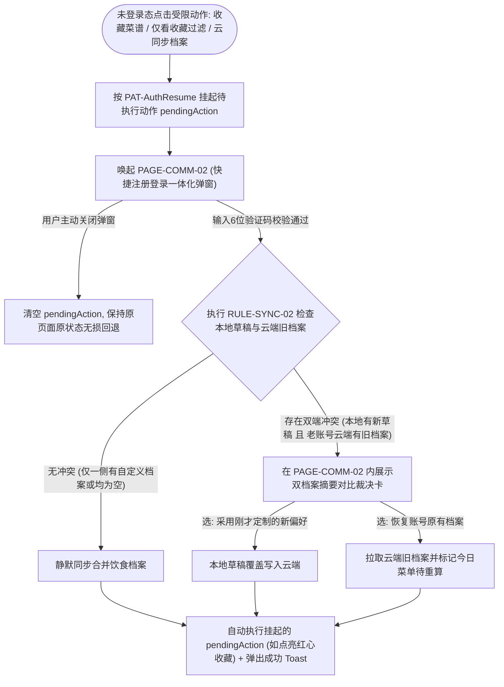

# 旅程阶段一：冷启动建档与身份转化流程（`FLOW-AUTH-*`）

## 1. `FLOW-AUTH-01`：新用户冷启动渐进式建档流

- **支撑功能**：[FEAT-01](../../01-vision-and-scope.md#feat-01)
- **涉及页面与规则**：[PAGE-COMM-01](../../06-pages/common-and-onboarding/onboarding-wizard.md#page-comm-01)、[PAGE-PLAN-01](../../06-pages/daily-plan/daily-meal-plan.md#page-plan-01)、[RULE-SYNC-01](../../03-business-rules/identity-and-sync.md#rule-sync-01)、[RULE-PLAN-02](../../03-business-rules/meal-recommendation.md#rule-plan-02)。

---

## 2. `FLOW-AUTH-02`：受限操作触发登录接续与云端旧档案合并流

- **支撑功能**：[FEAT-01](../../01-vision-and-scope.md#feat-01)、[FEAT-07](../../01-vision-and-scope.md#feat-07)
- **涉及模式与规则**：[PAT-AuthResume](../../05-components-and-patterns/interaction-patterns.md#pat-authresume)、[PAGE-COMM-02](../../06-pages/common-and-onboarding/auth-modal.md#page-comm-02)、[RULE-SYNC-02](../../03-business-rules/identity-and-sync.md#rule-sync-02)。
- **配套可交互微原型**：[flow-auth-and-merge.html](../../08-verification/prototypes/flows/flow-auth-and-merge.html)

