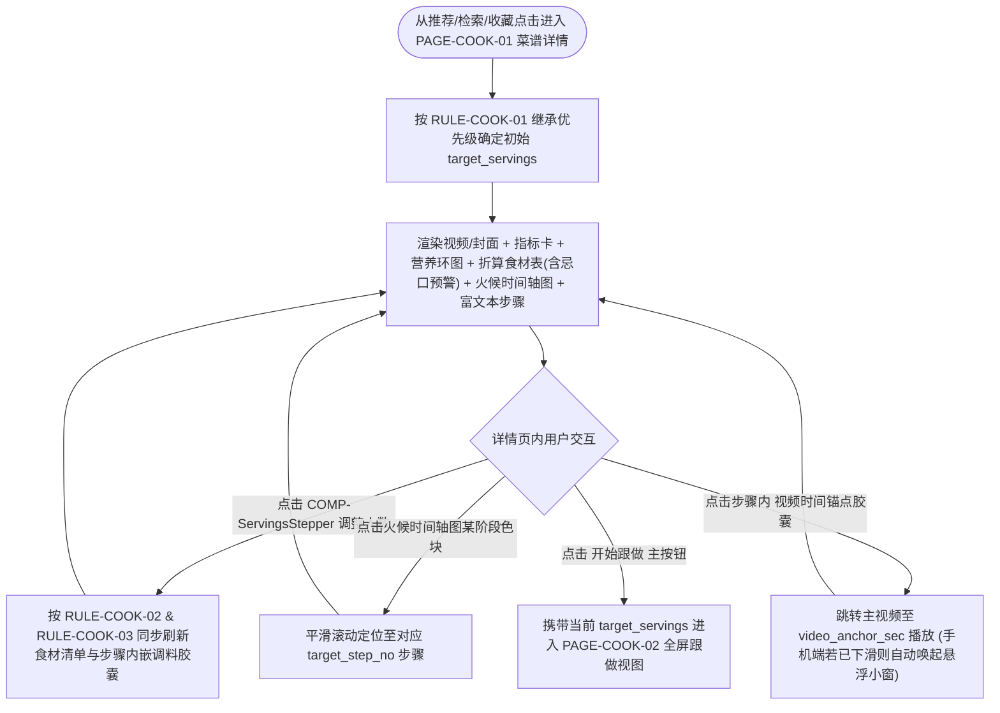
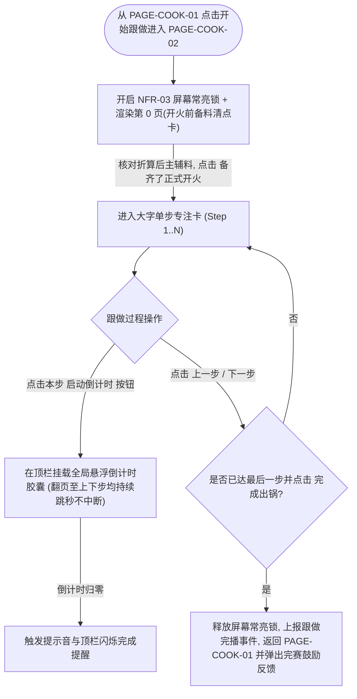

# 旅程阶段四：菜谱消费与实操跟做流程（`FLOW-COOK-*`）

## 1. `FLOW-COOK-01`：菜谱详情多媒体联动与动态分量换算流

- **支撑功能**：[FEAT-05](../../01-vision-and-scope.md#feat-05)
- **涉及页面与规则**：[PAGE-COOK-01](../../06-pages/recipe-consumption/recipe-detail.md#page-cook-01)、[RULE-COOK-01](../../03-business-rules/portion-and-cooking.md#rule-cook-01) ~ [RULE-COOK-03](../../03-business-rules/portion-and-cooking.md#rule-cook-03)、[RULE-SRCH-03](../../03-business-rules/search-and-matching.md#rule-srch-03)。

---

## 2. `FLOW-COOK-02`：全屏分步跟做与跨步骤悬浮倒计时完播流

- **支撑功能**：[FEAT-06](../../01-vision-and-scope.md#feat-06)
- **涉及页面与约束**：[PAGE-COOK-02](../../06-pages/recipe-consumption/cooking-focus-mode.md#page-cook-02)、[NFR-03](../../01-vision-and-scope.md#nfr-03)、[RULE-COOK-03](../../03-business-rules/portion-and-cooking.md#rule-cook-03)。

