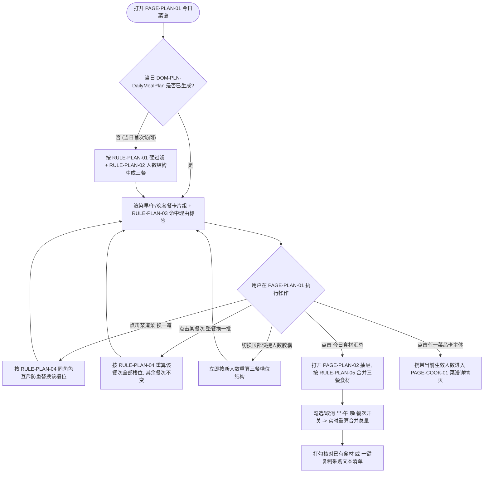
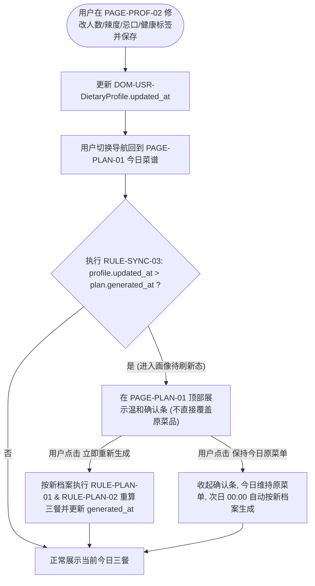

# 旅程阶段二：日常三餐规划与买菜核对流程（`FLOW-PLAN-*`）

## 1. `FLOW-PLAN-01`：今日三餐浏览、换菜与食材合并流

- **支撑功能**：[FEAT-02](../../01-vision-and-scope.md#feat-02)、[FEAT-03](../../01-vision-and-scope.md#feat-03)
- **涉及页面与规则**：[PAGE-PLAN-01](../../06-pages/daily-plan/daily-meal-plan.md#page-plan-01)、[PAGE-PLAN-02](../../06-pages/daily-plan/ingredient-summary-drawer.md#page-plan-02)、[RULE-PLAN-01](../../03-business-rules/meal-recommendation.md#rule-plan-01) ~ [RULE-PLAN-05](../../03-business-rules/meal-recommendation.md#rule-plan-05)。

---

## 2. `FLOW-PLAN-02`：修改饮食档案后的跨页温和重算闭环流

- **支撑功能**：[FEAT-01](../../01-vision-and-scope.md#feat-01)、[FEAT-02](../../01-vision-and-scope.md#feat-02)
- **涉及页面与规则**：[PAGE-PROF-02](../../06-pages/user-profile/dietary-archive-editor.md#page-prof-02)、[PAGE-PLAN-01](../../06-pages/daily-plan/daily-meal-plan.md#page-plan-01)、[RULE-SYNC-03](../../03-business-rules/identity-and-sync.md#rule-sync-03)。
- **配套可交互微原型**：[flow-profile-to-plan-sync.html](../../08-verification/prototypes/flows/flow-profile-to-plan-sync.html)

