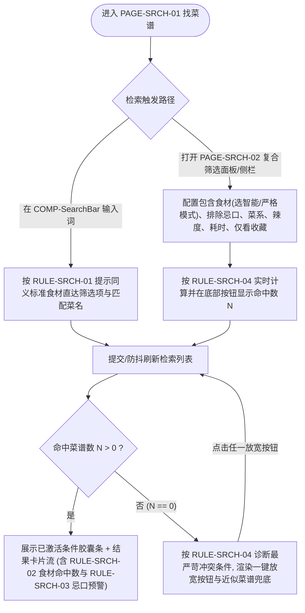
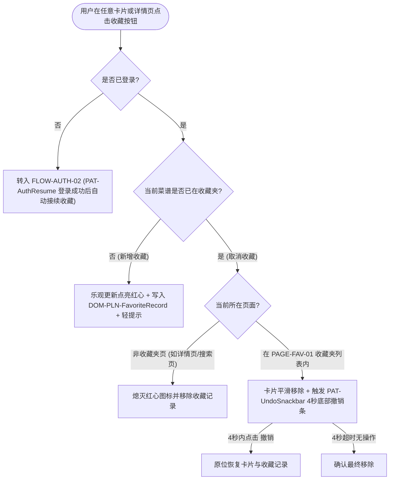

# 旅程阶段三：探索检索与收藏沉淀流程（`FLOW-DISC-*`）

## 1. `FLOW-DISC-01`：多维复合检索与零结果放宽兜底流

- **支撑功能**：[FEAT-04](../../01-vision-and-scope.md#feat-04)
- **涉及页面与规则**：[PAGE-SRCH-01](../../06-pages/recipe-discovery/recipe-search.md#page-srch-01)、[PAGE-SRCH-02](../../06-pages/recipe-discovery/complex-filter-panel.md#page-srch-02)、[RULE-SRCH-01](../../03-business-rules/search-and-matching.md#rule-srch-01) ~ [RULE-SRCH-04](../../03-business-rules/search-and-matching.md#rule-srch-04)。

---

## 2. `FLOW-DISC-02`：轻量单层收藏与 4 秒误触撤销保护流

- **支撑功能**：[FEAT-07](../../01-vision-and-scope.md#feat-07)
- **涉及页面与模式**：[PAGE-FAV-01](../../06-pages/favorites/favorites-list.md#page-fav-01)、[COMP-RecipeCard](../../05-components-and-patterns/shared-components.md#comp-recipecard)、[PAT-AuthResume](../../05-components-and-patterns/interaction-patterns.md#pat-authresume)、[PAT-UndoSnackbar](../../05-components-and-patterns/interaction-patterns.md#pat-undosnackbar)。

