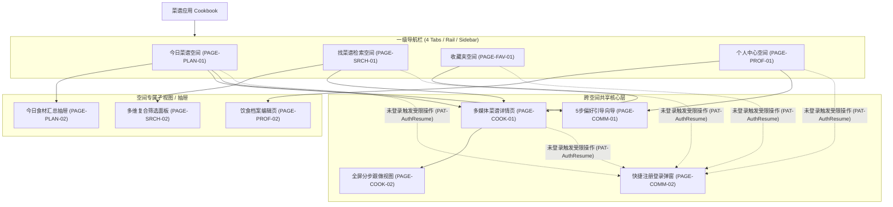

# 04-1. 全局信息架构与多端响应式容器壳（IA & Responsive Shell）

## 1. 全局导航拓扑（Information Architecture）

全站以 **4 个一级导航空间**承载日常高频入口，搭配 **2 个跨模块共享空间**（公共引导认证层、菜谱消费详情层），所有核心任务均在 `<= 2` 次页面跳转内可达：

> 完整页面权限与路由属性清单统一注册于 [06-pages/_index.md](../06-pages/_index.md)。

---

## 2. 三端响应式视口容器框架（`SHELL-*`）

响应 [NFR-01 Mobile-First 全端响应式一致性](../01-vision-and-scope.md#nfr-01)，定义三套标准视口容器壳，供所有 `PAGE-*` 规格书第 2 节引用：

| 容器壳 ID | 视口断点区间 | 典型设备与使用情境 | 一级导航栏形态 | 抽屉/次级面板形态 | 菜谱详情页主框架 |
| :--- | :--- | :--- | :--- | :--- | :--- |
| **SHELL-Mobile** | `< 768px` *(核心设计基准)* | 手机竖屏单手操作（通勤决策、超市核对、灶台速看） | **底部固定 4-Tab 栏**（高度 `60px`）；进入二级详情页时隐藏底部 Tab，切换为详情专属操作底栏 | **底部模态抽屉（Bottom Sheet）**，最大高度 `85vh` | 单栏纵向流；视频播放中滚出视口时自动吸附右上角悬浮小窗 |
| **SHELL-Tablet** | `768px ~ 1023px` | 平板横/竖屏支在厨房料理台面“边看视频边备菜下锅” | **左侧紧凑窄边栏（Navigation Rail，宽 `76px`）**，最大化纵向内容高度 | **右侧滑出抽屉（Side Drawer，宽 `380px`）** | **左右双栏独立滚动**：左栏（42%）常驻视频与食材换算表；右栏（58%）滚动双图表与步骤流 |
| **SHELL-Desktop** | `>= 1024px` | 桌面浏览器大屏检索、收藏整理与周末菜单规划 | **左侧展开式导航侧栏（宽 `220px`）**，主内容区最大宽度 `1200px` 居中 | 复合筛选直接展开为**左侧常驻过滤边栏**（勾选即实时防抖刷新列表）；其余抽屉为居中模态框或右侧滑层 | **主副双栏**：左主栏（64%）展示宽屏视频、图表与步骤；右吸顶栏（36%）常驻人数计算器与食材核对单 |
