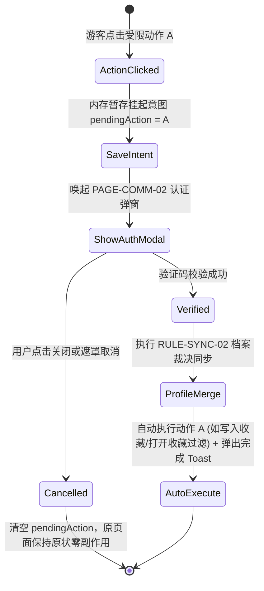

# 5-2. 全局通用交互模式契约（`PAT-*`）

## 1. `PAT-AuthResume`（受限操作登录拦截与自动接续模式）

- **适用范围**：未登录游客触发**点击收藏红心**、**开启「仅看已收藏」过滤开关**、**点击「云端保存我的饮食档案」**等强账号绑定动作时。
- **核心设计原则**：先逛后登不设墙；一旦用户为完成某个具体意图而完成登录，系统必须**自动帮用户把刚才被拦截的那一步做完**，严禁让用户关掉登录框再重新点一次！

---

## 2. `PAT-UndoSnackbar`（破坏性列表移除 4 秒撤销保护模式）

- **适用范围**：在 [PAGE-FAV-01 收藏夹](../06-pages/favorites/favorites-list.md#page-fav-01) 列表内点击红心移出菜谱等“点击后元素立即从当前列表消失”的操作。
- **时序与交互契约**：
  1. 用户点击取消收藏后，无需弹出烦人的二次确认模态框（`确定要取消收藏吗？`），列表项立即平滑收起隐藏。
  2. 屏幕底部中央浮现黑底悬浮胶囊条：`已将「{菜谱名}」移出收藏夹  [撤销]`，持续驻留 **`4000ms`**。
  3. 若在 `4000ms` 内点击 `[撤销]`：立即原位恢复该卡片与收藏状态；若期间又取消了另一道菜，前一条立即提交并刷新为最新一条的 `4000ms` 倒计时。

---

## 3. `PAT-ViewStates`（全局视图基础状态标准）

所有业务页面必须完整处理以下标准非正常态，确保 UI 设计与前端开发无遗漏：

| 状态分类 | 触发条件 | 规范化界面表现 |
| :--- | :--- | :--- |
| **加载态（Loading）** | 首屏数据或换一换计算耗时 `> 200ms` | 采用与卡片等高的脉冲骨架屏（Skeleton），单菜换一换采用原卡片局部微加载态，禁止全屏白屏转圈阻塞 |
| **空数据态（Empty）** | 收藏为 0、检索命中为 0、食材汇总未勾选任何餐次 | 必须同时包含：① 具象原因说明文案 + ② 至少 1 个可直接点击解决问题的行动按钮（CTA，如一键放宽条件或去推荐页） |
| **媒体/网络降级态（Degraded）** | 详情页教学视频加载超时或离线 | 视频容器优雅回退为 `cover_image_url` 高清静态图 + `[重试加载视频]` 小按钮，下方食材计算器与富文本步骤保持 100% 正常可用（契合 [NFR-02](../01-vision-and-scope.md#nfr-02)） |
