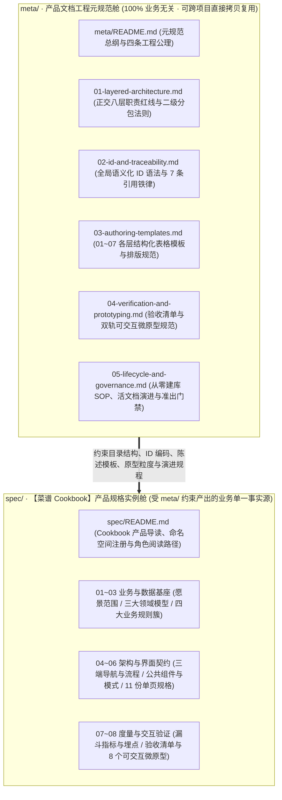

# 产品工程与规格仓库（Product Engineering Repository）

本目录（`Product/`）采用“**通用文档元规范**（`meta/`） + **具体产品规格实例**（`spec/`）”**双舱物理隔离架构**，将“**产品文档本身应当如何工程化组织与编写的方法论**”与“**本次【菜谱 Cookbook】项目的具体业务产品规格**”彻底解耦。

---

## 一、双舱架构关系总览



> **架构设计说明**：
> - **`meta/` 回答“产品文档怎么写”**：不包含任何与“菜谱”相关的字眼或业务耦合。未来启动任何新软件项目时，可直接将 `meta/` 整目录复制到新项目中作为现成的产品工程规范标准。
> - **`spec/` 回答“Cookbook 这个产品是什么”**：严格遵循 `meta/` 定义的八层正交结构、ID 锚点语法、表格契约与双轨微原型标准，完整承载【菜谱 Cookbook】当前生效的全部产品规格，直接驱动下游视觉设计（`../Design/`）与代码实现（`../Code/`）。

---

## 二、快速入口导航

### 1. 查阅通用产品文档元规范（[meta/README.md](./meta/README.md)）
| 元规范文档 | 核心定义内容 |
| :--- | :--- |
| [meta/README.md](./meta/README.md) | 四大工程公理（活文档基线、正交单一事实源、结构化契约行文、零背景自包含）与导读 |
| [meta/01-layered-architecture.md](./meta/01-layered-architecture.md) | `01` ~ `08` 正交八层目录拓扑、准入边界与越界禁令红线、二级子目录拆分法则、`_index.md` 公约 |
| [meta/02-id-and-traceability.md](./meta/02-id-and-traceability.md) | 16 类语义化 ID 编码语法、显式 HTML 锚点规范、跨层有向无环依赖图（DAG）、7 条引用完整性铁律 |
| [meta/03-authoring-templates.md](./meta/03-authoring-templates.md) | 行文与 Markdown/Mermaid 渲染安全基本法，`01` ~ `07` 各层必填章节与表格列模板 |
| [meta/04-verification-and-prototyping.md](./meta/04-verification-and-prototyping.md) | `Given-When-Then` 验收标准规范，以及拒绝巨型单体原型的“单页多状态画板 + 跨页动线沙盒”双轨微原型规范 |
| [meta/05-lifecycle-and-governance.md](./meta/05-lifecycle-and-governance.md) | 新项目 7 步冷启动建库 SOP、存量产品迭代的活文档原地更新规程、6 项提交门禁自检清单（DoD） |

### 2. 进入【菜谱 Cookbook】产品规格实例库（[spec/README.md](./spec/README.md)）
- **产品规格总导读与各角色阅读指南**：👉 **[打开 spec/README.md](./spec/README.md)**
- **可交互 HTML 微原型总控台源码**：👉 **[spec/08-verification/prototypes/index.html](./spec/08-verification/prototypes/index.html)**

---

## 三、本地浏览器一键运行预览（macOS / Windows 通用）

由于浏览器直接以本地文件协议（`file://`）打开 HTML 时，点击跳往 `.md` 规格书的链接会触发文件下载（而非网页渲染），且部分浏览器沙盒限制 `../../` 跨目录跳转，本目录内置了**零依赖跨平台预览脚本 [preview.js](./preview.js)**（无需执行 `npm install`，只要本地装有 Node.js 即可运行，同时自动渲染所有 `.md` 表格、锚点与 Mermaid 流程图）：

- **macOS / Linux 终端启动**：
  ```bash
  cd Product
  node preview.js
  ```
- **Windows（PowerShell 或 CMD）启动**：
  ```powershell
  cd Product
  node preview.js
  ```

执行后会自动唤起系统默认浏览器打开 **`spec/` 全库一页全景通览工作台**（默认地址 `http://127.0.0.1:8090/spec`，若端口占用会自动顺延）：
- **`http://127.0.0.1:8090/spec`（推荐 · 零新增文件全库一页通览）**：在单个网页内严格保持 `spec/` 完整物理目录树层级渲染全部 `41` 份 Markdown 规格书与 Mermaid 图表，支持基于 `.md` 原生相对引用与 `#anchor` 锚点的页内平滑定位高亮、“返回刚看处”悬浮胶囊、目录树全文/ID 实时过滤，以及“全库长卷 / 单篇聚焦”双模式切换；
- **`http://127.0.0.1:8090/meta`**：同构一页通览全部 `meta/` 元规范文档；
- **`http://127.0.0.1:8090/spec/08-verification/prototypes/index.html`**：打开双轨可交互 HTML 微原型总控台，与 Markdown 规格书无缝互跳（如需离线分享静态单文件快照，亦可运行 `node preview.js --export-spec spec-panorama.html` 导出）。

