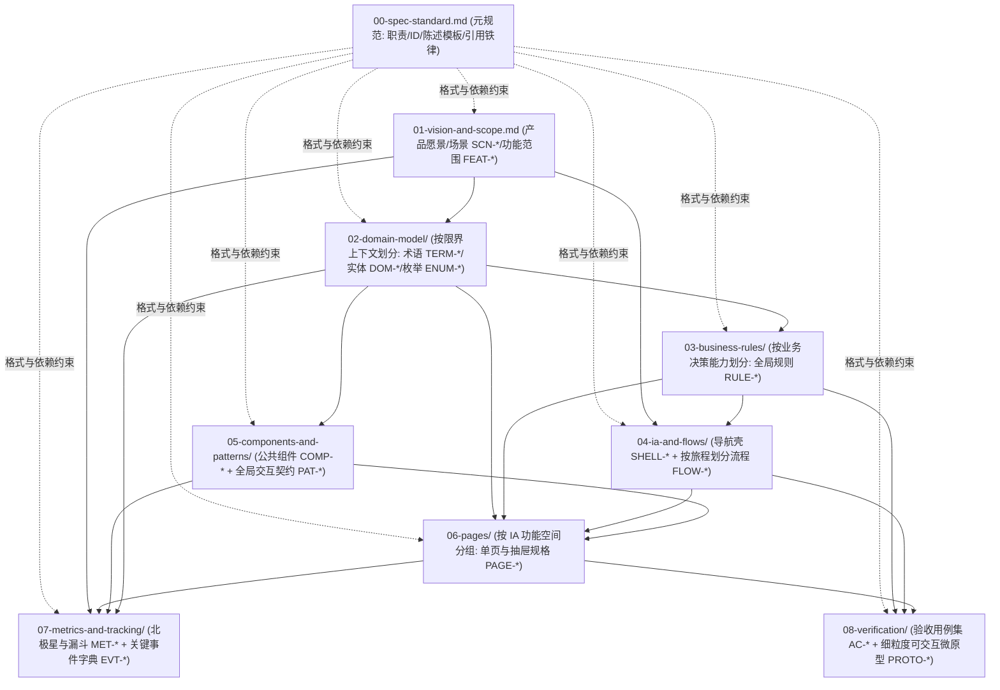

# 【菜谱 Cookbook】产品工程规范库（Product Specification Repository）

本目录（`Product/`）是【菜谱】应用的**产品单一事实源（Single Source of Truth）**，为下游视觉设计（`../Design/`）与多端工程实现（`../Code/`）提供正交解耦、双向可追溯的规格契约。

---

## 一、规范体系全景架构

---

## 二、目录索引与推荐阅读路径

| 层级 | 入口文档 | 二级分类标准 | 核心交付物 | 状态 |
| :--- | :--- | :--- | :--- | :--- |
| **00 元规范** | [00-spec-standard.md](./00-spec-standard.md) | 全局唯一 | 目录职责红线、语义化 ID 编码、陈述模板、7 条强制引用铁律 | ✅ 已定版 |
| **01 愿景与范围** | [01-vision-and-scope.md](./01-vision-and-scope.md) | 全局唯一 | 核心痛点、4 类场景（`SCN-*`）、7 项 MVP 功能边界（`FEAT-*`）、非功能约束（`NFR-*`） | ✅ 已定版 |
| **02 领域模型** | [02-domain-model/_index.md](./02-domain-model/_index.md) | **按限界上下文（子域）** | `user-profile/`、`recipe-catalog/`、`meal-and-collection/` 三大子域的术语、实体与枚举 | ✅ 已定版 |
| **03 业务规则** | [03-business-rules/_index.md](./03-business-rules/_index.md) | **按业务决策能力簇** | 配餐换菜、复合检索、分量换算、身份同步四大规则簇（共 15 条 `RULE-*`） | ✅ 已定版 |
| **04 架构与流程** | [04-ia-and-flows/ia-and-shell.md](./04-ia-and-flows/ia-and-shell.md) [04-ia-and-flows/flows/_index.md](./04-ia-and-flows/flows/_index.md) | **按用户价值旅程阶段** | 三端响应式导航壳（`SHELL-*`）、四大旅程阶段共 8 条端到端流程（`FLOW-*`）与跨页同步表 | ✅ 已定版 |
| **05 组件与交互** | [05-components-and-patterns/_index.md](./05-components-and-patterns/_index.md) | **公共组件 vs 交互契约** | 3 个跨页复用组件（`COMP-*`）+ 3 项全局交互模式契约（`PAT-*`） | ✅ 已定版 |
| **06 页面规格** | [06-pages/_index.md](./06-pages/_index.md) | **按 IA 功能空间分组** | 6 大功能空间共 11 份独立页面/子视图五段式规格书（`PAGE-*`） | ✅ 已定版 |
| **07 指标与埋点** | [07-metrics-and-tracking/metrics-funnel.md](./07-metrics-and-tracking/metrics-funnel.md) [07-metrics-and-tracking/event-dictionary.md](./07-metrics-and-tracking/event-dictionary.md) | **业务漏斗 vs 事件采集** | 北极星指标与 5 组漏斗公式（`MET-*`）+ 12 个关键业务事件字典（`EVT-*`） | ✅ 已定版 |
| **08 验收与原型** | [08-verification/acceptance-criteria.md](./08-verification/acceptance-criteria.md) [08-verification/prototypes/index.html](./08-verification/prototypes/index.html) | **方式 C 混合分层原型** | 端到端验收走查清单（`AC-*`）+ 6 个功能空间多状态画板 + 2 个跨页状态传递微原型 | ✅ 已定版 |

---

## 三、不同角色的阅读切入指南

- **产品评审 / 业务对齐**：按 `01` → `04` → 打开 [08-verification/prototypes/index.html](./08-verification/prototypes/index.html) 交互体验。
- **UI / UX 设计师（承接 `Design/`）**：重点阅读 `04-ia-and-shell.md` → `05-components-and-patterns/` → `06-pages/` 各页规格及配套单页多状态画板原型。
- **前后端工程师（承接 `Code/`）**：重点阅读 `02-domain-model/`（建表与接口 Schema）→ `03-business-rules/`（核心服务算法）→ `06-pages/` & `07-metrics-and-tracking/` → 对照 `08-verification/acceptance-criteria.md` 自测。
