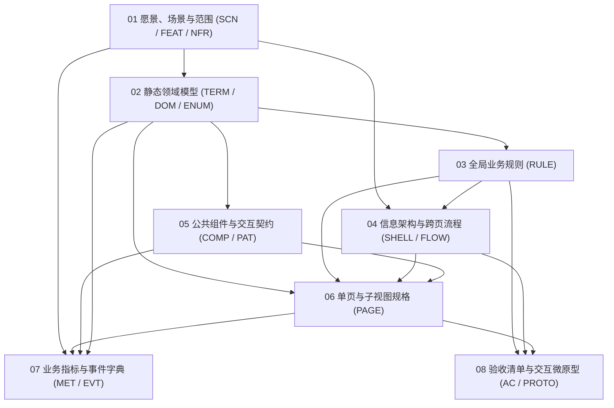

# 02. 全局语义化 ID 编码语法、依赖拓扑与跨层引用铁律

本文档规定产品规格库中所有核心条目的**唯一标识符编码语法、显式锚点规则、跨层有向无环依赖方向，以及 7 条强制完整性校验铁律（附正反示例）**。

> **阅读说明**：文中所有具体示例均采用中性的通用软件系统（如订单 `ORD`、计价 `PRIC`、结算页 `CHK`）作格式示范，与特定业务项目解耦。

---

## 1. 全局语义化 ID 编码语法

为确保需求条目可精准跨文档引用、中间插入新条目时不发生全库重编号雪崩、仅看 ID 即可一眼识别所属层级与业务归属，全库采用统一的语义化编码体系。

### 1.1 项目级命名空间缩写预注册规则
在具体项目的 `spec/README.md` 开篇，必须预先注册三组简短的大写英文命名空间缩写（建议 3~4 个字母）：
- `<DOM>`：**领域子域缩写**（用于 `02` 层，区分不同限界上下文的数据归属，*如 `USR` 用户域、`ORD` 订单域、`CAT` 商品域*）；
- `<CAP>`：**业务能力簇缩写**（用于 `03` 层规则与 `08` 层验收用例，区分核心决策主题，*如 `PRIC` 计价促销、`INV` 库存调拨、`AUTH` 身份同步*）；
- `<FLOW>` / `<SPACE>`：**用户旅程缩写 / 页面功能空间缩写**（用于 `04` 层流程与 `06` 层页面，*如 `ONBD` 引导注册、`SRCH` 检索发现、`CHK` 交易结算*）。

### 1.2 十六类标准条目 ID 格式与通用示例总表

| 所属层 | 条目类型 | 标准 ID 语法格式 | HTML 锚点格式（全小写） | 编号规则与通用写法示例 |
| :--- | :--- | :--- | :--- | :--- |
| `01` 愿景与范围 | 用户场景 | `SCN-<NN>` | `#scn-<nn>` | 两位序号递增。*示例：`SCN-01`（高频差旅人士机场极速改签场景）* |
| `01` 愿景与范围 | 功能版图项 | `FEAT-<NN>` | `#feat-<nn>` | 两位序号递增。*示例：`FEAT-02`（多维条件航班检索与低价日历）* |
| `01` 愿景与范围 | 非功能约束 | `NFR-<NN>` | `#nfr-<nn>` | 两位序号递增。*示例：`NFR-01`（手机/平板/桌面三端响应式一致性）* |
| `02` 领域模型 | 业务术语 | `TERM-<DOM>-<NN>` | `#term-<dom>-<nn>` | 按子域各自递增。*示例：`TERM-ORD-01`（可退改票面净价定义）* |
| `02` 领域模型 | 领域实体 | `DOM-<DOM>-<PascalName>` | `#dom-<dom>-<lowername>` | 英文大驼峰实体名。*示例：`DOM-ORD-Order`（交易订单聚合根实体）* |
| `02` 领域模型 | 标准枚举 | `ENUM-<DOM>-<PascalName>` | `#enum-<dom>-<lowername>` | 英文大驼峰枚举名。*示例：`ENUM-ORD-OrderStatus`（订单生命周期状态枚举）* |
| `03` 业务规则 | 业务规则 | `RULE-<CAP>-<NN>` | `#rule-<cap>-<nn>` | 按能力簇各自递增。*示例：`RULE-PRIC-01`（跨店满减与店铺券叠加计价规则）* |
| `04` 架构与流程 | 视口容器壳 | `SHELL-<Viewport>` | `#shell-<viewport>` | 按断点语义命名。*示例：`SHELL-Mobile`、`SHELL-Tablet`、`SHELL-Desktop`* |
| `04` 架构与流程 | 跨页业务流 | `FLOW-<FLOW>-<NN>` | `#flow-<flow>-<nn>` | 按旅程阶段递增。*示例：`FLOW-CHK-01`（购物车合并结算至支付成功闭环流）* |
| `05` 组件与交互 | 公共组件 | `COMP-<PascalName>` | `#comp-<lowername>` | 大驼峰组件语义名。*示例：`COMP-ProductCard`（跨页复用商品摘要卡片）* |
| `05` 组件与交互 | 交互模式 | `PAT-<PascalName>` | `#pat-<lowername>` | 大驼峰交互契约名。*示例：`PAT-AuthResume`（未登录拦截后自动接续原操作模式）* |
| `06` 页面规格 | 页面/子视图 | `PAGE-<SPACE>-<NN>` | `#page-<space>-<nn>` | 按功能空间递增。*示例：`PAGE-CHK-01`（确认订单主页）、`PAGE-CHK-02`（优惠券选择抽屉）* |
| `07` 指标与埋点 | 业务指标 | `MET-NSM` 或 `MET-<NN>` | `#met-nsm` / `#met-<nn>` | 北极星固定 `MET-NSM`，其余递增。*示例：`MET-01`（搜索至加购漏斗转化率）* |
| `07` 指标与埋点 | 埋点事件 | `EVT-<NN>` | `#evt-<nn>` | 两位序号递增。*示例：`EVT-04`（`checkout_submitted` 提交订单按钮点击事件）* |
| `08` 验收与原型 | 验收用例 | `AC-<CAP>-<NN>` | `#ac-<cap>-<nn>` | 按能力簇递增。*示例：`AC-PRIC-02`（优惠券门槛临界值退回重算验收）* |
| `08` 验收与原型 | 交互微原型 | `PROTO-PAGE-<SPACE>` `PROTO-FLOW-<KEY>` | —（对应独立 `.html` 文件） | 对应状态画板或跨页沙盒。*示例：`PROTO-PAGE-CHK`（结算空间多状态画板）* |

---

## 2. 显式锚点声明与“禁裸 ID”自解释引用规范

### 2.1 定义端显式 HTML 锚点语法
由于 GitHub、VS Code 及各类静态文档站对“含中文、括号、斜杠或反引号的 Markdown 标题”自动生成的隐式锚点规则互不兼容，极易导致点击跳转失效，本规范强制执行**显式全小写 HTML `` 锚点 + 相对路径链接**：

- **独立小节标题埋点示例**：
  ``## 1. `RULE-PRIC-01`（多重优惠叠加计价规则）``
- **表格行首列埋点示例**（适用于 `SCN-*`、`FEAT-*`、`EVT-*`、`AC-*` 等行级条目）：
  `| **SCN-01** | 高频差旅人士 | ... |`

### 2.2 消费端“禁裸 ID”语义伴随引用法则（解决频繁跳转痛点）
为根治读者因满屏裸代号被迫反复跨文件查字典的阅读断层，全库所有跨文件引用必须遵守 **“不跳转即可读懂本句业务主旨，需查底层完整边界时一键点击直达”** 准则，严格执行以下 **6 类标准伴随写法**与 **2 条引用禁令**：

| 引用目标类型 | ❌ 禁止的“裸代号”写法（逼迫读者跳页查表） | ✅ 强制的“编码 + 中文语义名 + 微摘要”写法 | 边界拿捏说明（既流畅好读又不违反单一事实源） |
| :--- | :--- | :--- | :--- |
| **1. 场景 / 功能 / 约束** (`SCN` / `FEAT` / `NFR`) | 支撑 `[SCN-01](#scn-01)`、`[FEAT-02](...)` | 支撑 `[SCN-01 行政月度集中集采](#scn-01)`、`[FEAT-02 多地址拆单](./01-vision-and-scope.md#feat-02)` | 链接文本自带 `ID + 中文短名`，一眼看清业务归属 |
| **2. 业务规则引用** (`RULE-*`) | 调用 `[RULE-PRIC-01] ~ [RULE-PRIC-03]` | 调用 `[RULE-PRIC-01 满减与会员折叠加计价](...)`（先扣满减再打折，保底 `1` 分） | 点明规则名称与半句核心判据；完整公式矩阵仍在 `03` 唯一维护 |
| **3. 视图 / 外壳 / 组件 / 模式** (`PAGE` / `SHELL` / `COMP` / `PAT`) | 挂载 `[SHELL-Mobile]`，触发 `[PAT-AuthResume]` 跳 `PAGE-CHK-01` | 挂载 `[SHELL-Mobile 手机竖屏底栏壳 (<768px)](...)`，触发 `[PAT-AuthResume 未登录拦截并自动接续](...)` 唤起弹窗，通过后进 `[PAGE-CHK-01 确认订单页](...)` | 消除英文缩写隔阂，在单页文档当场看清断点宽度与交互动作 |
| **4. 领域实体与英文字段** (`DOM-*` + `fieldName`) | 比对 `DOM-ORD-Order` 的 `payableCents` 与 `updatedAt` | 读取 `[DOM-ORD-Order 交易订单](...)` 的**实付总金额**（`payableCents`）与**最后更新时间**（`updatedAt`） | 正文与表格中首次出现的数据库英文字段必须采用 **`中文名（英文名）`** 对照呈现 |
| **5. 标准枚举绑定** (`ENUM-*`) | 绑定 `[ENUM-ORD-OrderStatus]` | 绑定 `[ENUM-ORD-OrderStatus 订单状态枚举](...)`（含待付款/待发货/已完成等 `6` 态） | 括号内仅举 `2~3` 个代表项让读者秒懂控件长相，不平铺抄写全部枚举编码表 |
| **6. 指标公式与埋点事件** (`MET-*` / `EVT-*`) | 转化率 = `[EVT-04]` ÷ `[EVT-02]`；上报 `[EVT-04]` | 转化率 = 提交订单会话数（`[EVT-04 提交订单]`）÷ 执行检索会话数（`[EVT-02 商品检索]`）；上报 `[EVT-04 提交订单 (checkout_submitted)]` | 杜绝密码本式的纯代号除法公式，让业务方与研发无需翻字典即可直读漏斗 |

- **引用禁令 A（严禁区间省略跳号）**：严禁写成 `执行 [RULE-01] ~ [RULE-04]` 掩盖中间规则名称，凡实际参与调用的规则必须逐条列出名称与链接。
- **引用禁令 B（严禁无链接的跨层死文本）**：在索引表、事件表或流程说明中跨文件提及上游/下游 ID 时，必须附带精准指向 `#anchor` 的可点击相对链接，严禁只写纯文本 `` `RULE-PRIC-01` `` 逼迫读者手动去文件夹翻找。

---

## 3. 跨层依赖方向（DAG 有向无环约束）

信息必须严格沿“**范围定义 → 静态数据建模 → 动态规则与公共零件 → 流程串联与单页组装 → 度量埋点与原型验收**”单向流动，**严禁上游基础层反向耦合下游表现层**（注：`03` 规则末尾附带的“下游消费索引”仅作影响面导航备查，规则本身的判定逻辑严禁依赖具体页面 UI 状态）：

---

## 4. 七条强制引用完整性铁律（附合格与违规对比）

任何产品规格库在建库完成或迭代修改后，必须满足以下 7 条完整性铁律：

- **铁律 1（功能必溯源场景）**：`01` 中的任意功能项 `FEAT-*` 必须至少链接 1 个目标用户场景 `SCN-*`。
  - ✅ *合格*：`FEAT-03 批量导入采购单` → 支撑场景链接至 `[SCN-02 企业采购员月度集中补货]`。
  - ❌ *违规*：凭个人喜好塞入“内置积分抽盲盒小游戏”，但全篇没有任何 `SCN-*` 用户痛点与之对应。

- **铁律 2（规则禁私造字段）**：`03` 中任意业务规则 `RULE-*` 读取的输入属性与枚举码，必须显式链接至 `02` 已注册的 `DOM-*` 或 `ENUM-*`。
  - ✅ *合格*：规则输入契约写明“读取 `DOM-USR-Member.vipLevel`（取值见 `ENUM-USR-VipTier`）”。
  - ❌ *违规*：规则正文中突然出现“若用户的 `creditScore > 700` 则免押金”，但 `02` 用户实体表中根本没有定义 `creditScore` 字段。

- **铁律 3（流程节点必有归属）**：`04` 中任意跨页流程图 `FLOW-*` 的视图节点必须标注 `[PAGE-*]`，关键分支判断菱形必须标注判定依据 `[RULE-*]` 或 `[PAT-*]`。
  - ✅ *合格*：流程图节点标注 `["[PAGE-CHK-01] 确认订单页"]`，分支菱形标注 `{"是否满足免邮门槛? [RULE-PRIC-02]"}`。
  - ❌ *违规*：流程图里画了一个叫“优惠处理页”的方框，但去 `06-pages/` 里根本找不到对应的页面规格书。

- **铁律 4（单页规格零冗余组装）**：`06` 中任意单页文档 `PAGE-*` 严禁平铺抄写枚举项、严禁重写计算公式、严禁重复描述公共组件内部结构与通用交互状态机，一律通过链接引用。
  - ✅ *合格*：单页规格写明“排序下拉框绑定枚举 `[ENUM-CAT-SortType]`；点击收藏若未登录执行 `[PAT-AuthResume]`”。
  - ❌ *违规*：在搜索页、分类页、收藏页三份单页文档里把“综合排序/销量优先/价格升序”列表各自手抄一遍，后续新增排序项时漏改其中两处。

- **铁律 5（指标与事件双向闭环）**：`07` 中任意指标 `MET-*` 的分子/分母必须精确由 `EVT-*` 事件导出；任意事件 `EVT-*` 必须标明触发载体（`PAGE-*`/`COMP-*`）且至少服务于 1 个 `MET-*` 指标。
  - ✅ *合格*：`MET-01` 公式引用 `EVT-02 ÷ EVT-01`；`EVT-02` 在 `PAGE-CHK-01` 第 5 节交互事件表中明确挂载。
  - ❌ *违规*：指标写“提升用户满意度”（无事件公式支撑的虚空口号），或定义了 30 个没有任何指标使用的僵尸曝光事件。

- **铁律 6（原型与页面状态 1:1 咬合）**：`08` 中的功能空间画板原型 `PROTO-PAGE-*` 顶栏提供的状态切换按钮，必须完整覆盖对应 `PAGE-*` 第 4 节“页面级状态枚举表”中的全部状态编码（`S1`、`S2`...），不多、不少、同名对齐。
  - ✅ *合格*：`PAGE-CHK-01` 第 4 节定义了 `S1 正常态 / S2 无收货地址态 / S3 存在失效商品态`，对应 HTML 画板顶栏恰好提供同名三颗一键切换按钮。
  - ❌ *违规*：规格书写了 4 种异常态，但 HTML 原型只画了 1 个正常态，导致设计师遗漏空状态和报错态视觉稿。

- **铁律 7（规则边界必有验收覆盖）**：`03` 中每条业务规则 `RULE-*` 的正常逻辑与降级兜底（Fallback）分支，在 `08` 验收清单中必须有至少 1 条 `AC-*` 用例显式验证。
  - ✅ *合格*：针对推荐规则的“候选集为空时降级返回全站热门榜单”兜底分支，在 `acceptance-criteria.md` 中设有专门的 `AC-*` 构造极端过滤条件加以验证。
  - ❌ *违规*：验收用例只测顺利下单的 Happy Path，对库存不足、网络超时、数据冲突等兜底规则零覆盖。
