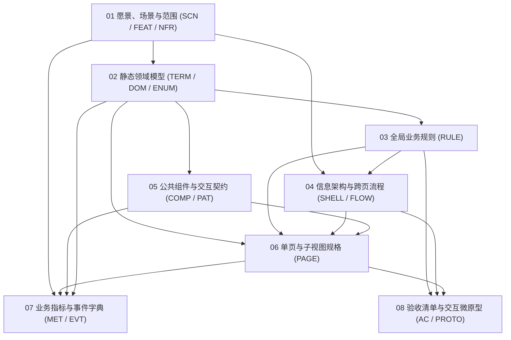

# 02. 全局语义化 ID 编码语法、依赖拓扑与跨层引用铁律

本文档规定产品规格库中所有核心条目的**唯一标识符编码语法、显式锚点规则、跨层有向无环依赖方向，以及 7 条强制完整性校验铁律**。

---

## 1. 全局语义化 ID 编码语法

为确保需求可精准引用、中间插入新条目时不发生断号雪崩、阅读 ID 即可一眼识别其所属层次与业务域，全库采用统一的语义化编码格式：

### 1.1 命名空间约定
在具体项目的 `spec/README.md` 中，必须预先声明三组简短的大写英文缩写（通常 3~4 个字母）：
- `<DOM>`：**领域子域缩写**（用于 `02` 层，区分不同限界上下文的数据归属）；
- `<CAP>`：**业务能力簇缩写**（用于 `03` 层与 `08` 层验收用例，区分不同核心决策能力）；
- `<FLOW>` / `<SPACE>`：**用户旅程缩写 / 功能空间缩写**（用于 `04` 层与 `06` 层，区分不同流程阶段与页面空间）。

### 1.2 十六类标准条目 ID 格式总表

| 所属层 | 条目类型 | 标准 ID 语法格式 | HTML 锚点命名规则（全小写连字符） | 编号递增与命名准则 |
| :--- | :--- | :--- | :--- | :--- |
| `01` | 用户场景 | `SCN-<NN>` | `#scn-<nn>` | 两位数字递增（`01`, `02`...），废弃不重用 |
| `01` | 功能版图项 | `FEAT-<NN>` | `#feat-<nn>` | 两位数字递增，代表一项内聚的产品能力 |
| `01` | 非功能约束 | `NFR-<NN>` | `#nfr-<nn>` | 两位数字递增，代表多端、性能、离线、无障碍等全局约束 |
| `02` | 业务术语 | `TERM-<DOM>-<NN>` | `#term-<dom>-<nn>` | 按所属领域子域分别两位数字递增 |
| `02` | 领域实体 | `DOM-<DOM>-<PascalName>` | `#dom-<dom>-<lowername>` | 使用英文大驼峰语义名，与数据模型/类命名对齐 |
| `02` | 标准枚举 | `ENUM-<DOM>-<PascalName>` | `#enum-<dom>-<lowername>` | 使用英文大驼峰语义名，代表一组封闭取值字典 |
| `03` | 业务规则 | `RULE-<CAP>-<NN>` | `#rule-<cap>-<nn>` | 按所属业务决策能力簇分别两位数字递增 |
| `04` | 视口容器壳 | `SHELL-<Viewport>` | `#shell-<viewport>` | 按响应式断点语义命名（如 `Mobile` / `Tablet` / `Desktop`） |
| `04` | 跨页业务流 | `FLOW-<FLOW>-<NN>` | `#flow-<flow>-<nn>` | 按用户旅程阶段缩写分别两位数字递增 |
| `05` | 公共组件 | `COMP-<PascalName>` | `#comp-<lowername>` | 使用大驼峰组件语义名 |
| `05` | 交互模式 | `PAT-<PascalName>` | `#pat-<lowername>` | 使用大驼峰交互契约语义名 |
| `06` | 页面/子视图 | `PAGE-<SPACE>-<NN>` | `#page-<space>-<nn>` | 按所属 IA 功能空间分别两位数字递增 |
| `07` | 业务指标 | `MET-NSM` 或 `MET-<NN>` | `#met-nsm` / `#met-<nn>` | 北极星指标固定为 `MET-NSM`，其余漏斗指标组按两位数字递增 |
| `07` | 埋点事件 | `EVT-<NN>` | `#evt-<nn>` | 两位数字递增，代表一个关键业务采集事件 |
| `08` | 验收用例 | `AC-<CAP>-<NN>` | `#ac-<cap>-<nn>` | 按业务能力缩写分组递增 |
| `08` | 交互微原型 | `PROTO-PAGE-<SPACE>` / `PROTO-FLOW-<KEY>` | —（对应独立 `.html` 文件） | 分别对应功能空间多状态画板与跨页状态传递微原型 |

---

## 2. 显式锚点声明与跨文件引用标准语法

由于不同 Markdown 渲染引擎对含中文、括号与标点的标题自动生成的隐式锚点规则不一致，本规范强制要求使用**显式 HTML 锚点 + 相对路径链接**：

1. **定义处写法（被引用端）**：在条目所在章节标题或表格首列内植入全小写显式 `` 标签：
   - 章节标题定义示例：`## 1. RULE-CAP-01（规则标准名称）`
   - 表格行内定义示例：`| **SCN-01** | ... |`
2. **引用处写法（消费端）**：统一以条目 ID 作为链接文本前缀，使用相对文件系统的路径加 `#锚点`：
   - 标准语法：`[RULE-CAP-01](../../03-business-rules/<file>.md#rule-cap-01)`
   - 同文件内引用：`[SCN-01](#scn-01)`

---

## 3. 跨层依赖方向（DAG 有向无环约束）

信息只能从基础定义层流向下游组装与验证层，**严禁上游基础层反向依赖下游具象层**（例如：严禁在 `02` 静态实体定义中耦合某个具体页面的 UI 状态；严禁在 `03` 业务规则算法中写死某个按钮位置，但可在规则末尾附带非耦合的“下游消费索引”供影响面排查）：

---

## 4. 七条强制引用完整性铁律（Spec Integrity Rules）

任何产品规格库在新增或修改文档后，必须同时满足以下 7 条闭环约束：

- **铁律 1（功能必溯源场景）**：`01` 中的任意功能项 `FEAT-*` 必须至少关联引用 1 个目标场景 `SCN-*`；无真实用户场景支撑的功能不得纳入产品版图。
- **铁律 2（规则禁私造字段）**：`03` 中任意业务规则 `RULE-*` 所读取的输入字段与枚举值，必须显式链接至 `02` 中已正式注册的 `DOM-*` 或 `ENUM-*`，严禁在规则中凭空发明未建模的隐式字段。
- **铁律 3（流程节点必有归属）**：`04` 中任意跨页流程 `FLOW-*` 的视图节点必须标注对应的 `[PAGE-*]`，关键条件分支菱形必须标注判定依据 `[RULE-*]` 或 `[PAT-*]`。
- **铁律 4（单页规格零冗余组装）**：`06` 中任意单页文档 `PAGE-*` 严禁平铺抄写枚举值列表、严禁重写业务计算公式、严禁重复描述公共组件内部结构与通用交互状态机，必须 100% 通过 ID 锚点链接引用上游定义。
- **铁律 5（指标与事件双向闭环）**：`07` 中任意业务指标 `MET-*` 的计算公式分子/分母必须精确绑定至 `EVT-*` 事件；反之，任意埋点事件 `EVT-*` 必须标明触发载体（`PAGE-*` 或 `COMP-*`），且至少被 1 个 `MET-*` 指标消费（消灭无人消费的僵尸埋点）。
- **铁律 6（原型与页面状态 1:1 咬合）**：`08` 中的功能空间画板原型 `PROTO-PAGE-*` 顶栏提供的状态切换按钮，必须完整覆盖对应 `PAGE-*` 规格书“第 4 节：页面级状态枚举表”中定义的全部状态编码（如 `S1`、`S2`、`S3`...），做到不多、不少、同名对齐。
- **铁律 7（规则边界必有验收覆盖）**：`03` 中每条核心业务规则 `RULE-*` 的主干逻辑及其边界降级兜底（Fallback）分支，在 `08` 的验收清单中必须有至少 1 条 `AC-*` 用例显式验证。
