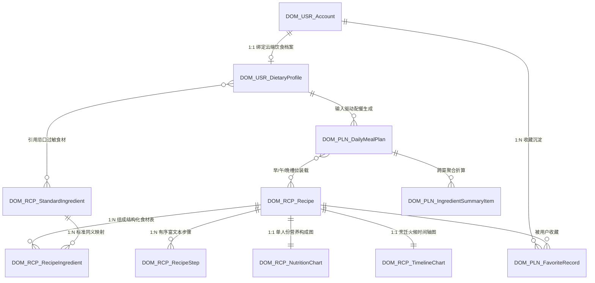

# 02. 领域模型与数据字典总索引（Domain Model Index）

## 1. 子域划分标准（Bounded Context Partitioning）

本目录按**静态业务对象的数据所有权与生命周期内聚性**（限界上下文）划分为三大业务域包。鉴于当前各域实体数量适中（每域 2~6 个实体），内部采用元规范定义的**轻量平铺包形态**，分别拆分为 `terms.md`（领域术语）、`entities.md`（实体结构契约）与 `enums.md`（标准枚举字典）；未来若单域聚合显著增多，可沿聚合簇平滑下钻为二级子包：

| 子域目录 | 子域名称 | ID 命名空间 | 核心聚合与职责范围 |
| :--- | :--- | :--- | :--- |
| [user-profile/](./user-profile/entities.md) | **用户与饮食画像域** | `*-USR-*` | 用户账号（`Account`）、五维个人饮食档案（`DietaryProfile`）及人群/忌口/厨具等 8 套偏好枚举 |
| [recipe-catalog/](./recipe-catalog/entities.md) | **菜谱与标准食材域** | `*-RCP-*` | 标准食材同义词库（`StandardIngredient`）、结构化菜谱聚合（`Recipe`、食材明细、动态步骤、营养与火候双图表）及 7 套量纲枚举 |
| [meal-and-collection/](./meal-and-collection/entities.md) | **膳食规划与收藏域** | `*-PLN-*` | 每日三餐推荐单（`DailyMealPlan`）、当日跨菜谱食材汇总项（`IngredientSummaryItem`）、收藏记录（`FavoriteRecord`）及 3 套匹配排序枚举 |

---

## 2. 全局跨子域实体关系总图（Context & ER Map）

---

## 3. 全量领域条目注册导航表（附中文语义速查）

### 3.1 用户与饮食画像域（`user-profile/`）
- **术语字典**：[TERM-USR-01 饮食画像](./user-profile/terms.md#term-usr-01) · [TERM-USR-02 本地偏好草稿](./user-profile/terms.md#term-usr-02) · [TERM-USR-03 硬性饮食约束](./user-profile/terms.md#term-usr-03)
- **数据实体**：[DOM-USR-Account 用户账号](./user-profile/entities.md#dom-usr-account) · [DOM-USR-DietaryProfile 个人饮食画像](./user-profile/entities.md#dom-usr-dietaryprofile)
- **标准枚举**：[ENUM-USR-Purpose 使用目的](./user-profile/enums.md#enum-usr-purpose) · [ENUM-USR-HouseholdSize 用餐人数档位](./user-profile/enums.md#enum-usr-householdsize) · [ENUM-USR-Flavor 风味喜好](./user-profile/enums.md#enum-usr-flavor) · [ENUM-USR-AvoidTag 高频忌口大类](./user-profile/enums.md#enum-usr-avoidtag) · [ENUM-USR-SkillLevel 厨艺等级](./user-profile/enums.md#enum-usr-skilllevel) · [ENUM-USR-TimeBudget 单餐耗时预算](./user-profile/enums.md#enum-usr-timebudget) · [ENUM-USR-Appliance 可用厨房厨具](./user-profile/enums.md#enum-usr-appliance) · [ENUM-USR-HealthTag 健康饮食标签](./user-profile/enums.md#enum-usr-healthtag)

### 3.2 菜谱与标准食材域（`recipe-catalog/`）
- **术语字典**：[TERM-RCP-01 标准食材库](./recipe-catalog/terms.md#term-rcp-01) · [TERM-RCP-02 基准人份](./recipe-catalog/terms.md#term-rcp-02) · [TERM-RCP-03 一碗端](./recipe-catalog/terms.md#term-rcp-03) · [TERM-RCP-04 步骤动态占位符](./recipe-catalog/terms.md#term-rcp-04)
- **数据实体**：[DOM-RCP-StandardIngredient 标准食材主数据](./recipe-catalog/entities.md#dom-rcp-standardingredient) · [DOM-RCP-Recipe 菜谱核心聚合根](./recipe-catalog/entities.md#dom-rcp-recipe) · [DOM-RCP-RecipeIngredient 结构化食材项](./recipe-catalog/entities.md#dom-rcp-recipeingredient) · [DOM-RCP-RecipeStep 富文本步骤项](./recipe-catalog/entities.md#dom-rcp-recipestep) · [DOM-RCP-NutritionChart 单人营养构成图](./recipe-catalog/entities.md#dom-rcp-nutritionchart) · [DOM-RCP-TimelineChart 工序火候时间轴图](./recipe-catalog/entities.md#dom-rcp-timelinechart)
- **标准枚举**：[ENUM-RCP-Cuisine 菜系分类](./recipe-catalog/enums.md#enum-rcp-cuisine) · [ENUM-RCP-MealSlot 每日餐次槽位](./recipe-catalog/enums.md#enum-rcp-mealslot) · [ENUM-RCP-DishRole 套餐配餐角色](./recipe-catalog/enums.md#enum-rcp-dishrole) · [ENUM-RCP-Spiciness 通用辣度分级](./recipe-catalog/enums.md#enum-rcp-spiciness) · [ENUM-RCP-Difficulty 烹饪难度](./recipe-catalog/enums.md#enum-rcp-difficulty) · [ENUM-RCP-ScaleMode 食材取整模式](./recipe-catalog/enums.md#enum-rcp-scalemode) · [ENUM-RCP-HeatLevel 图表火力等级](./recipe-catalog/enums.md#enum-rcp-heatlevel)

### 3.3 膳食规划与收藏域（`meal-and-collection/`）
- **术语字典**：[TERM-PLN-01 餐次套餐结构](./meal-and-collection/terms.md#term-pln-01) · [TERM-PLN-02 同餐主材互斥](./meal-and-collection/terms.md#term-pln-02) · [TERM-PLN-03 画像待刷新态](./meal-and-collection/terms.md#term-pln-03)
- **数据实体**：[DOM-PLN-DailyMealPlan 每日三餐推荐单](./meal-and-collection/entities.md#dom-pln-dailymealplan) · [DOM-PLN-IngredientSummaryItem 跨菜谱食材合并项](./meal-and-collection/entities.md#dom-pln-ingredientsummaryitem) · [DOM-PLN-FavoriteRecord 菜谱收藏记录](./meal-and-collection/entities.md#dom-pln-favoriterecord)
- **标准枚举**：[ENUM-PLN-IngMatchMode 多食材匹配模式](./meal-and-collection/enums.md#enum-pln-ingmatchmode) · [ENUM-PLN-SortOrder 列表排序方式](./meal-and-collection/enums.md#enum-pln-sortorder) · [ENUM-PLN-SummaryCategory 采购货架分组](./meal-and-collection/enums.md#enum-pln-summarycategory)
