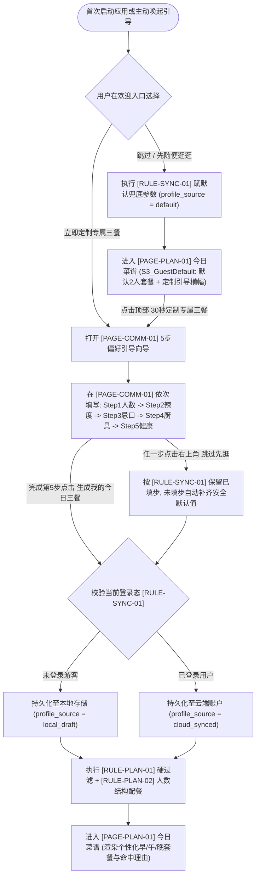
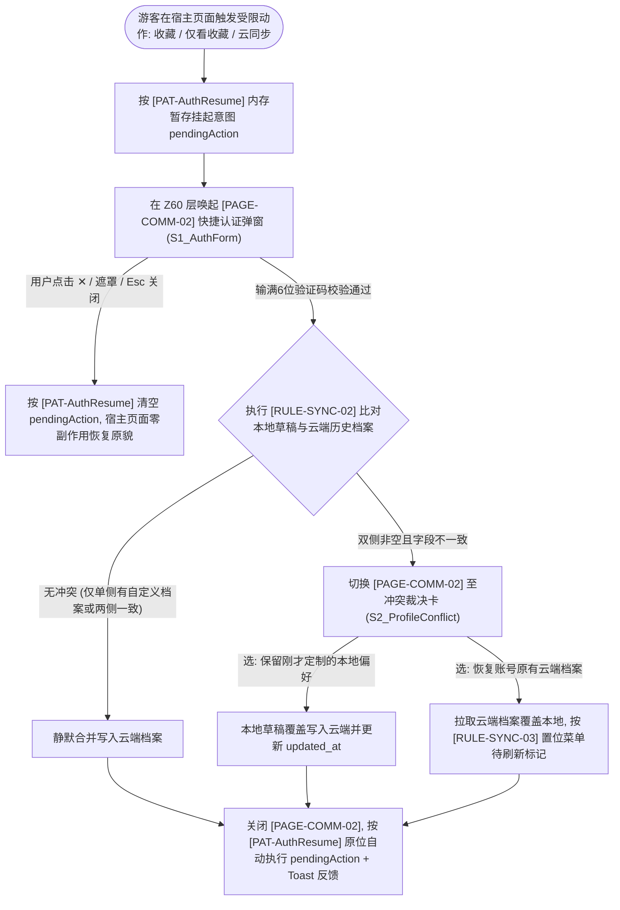

# 旅程阶段一：冷启动建档与身份转化流程（`FLOW-AUTH-*`）

## 1. `FLOW-AUTH-01`：新用户冷启动渐进式建档流

- **1. 关联范围与前置条件**（Given）：
  - **支撑功能**：[FEAT-01](../../01-vision-and-scope.md#feat-01)
  - **涉及视图与规则**：[PAGE-COMM-01](../../06-pages/common-and-onboarding/onboarding-wizard.md#page-comm-01)、[PAGE-PLAN-01](../../06-pages/daily-plan/daily-meal-plan.md#page-plan-01)、[RULE-SYNC-01](../../03-business-rules/identity-and-sync.md#rule-sync-01)、[RULE-PLAN-01](../../03-business-rules/meal-recommendation.md#rule-plan-01)、[RULE-PLAN-02](../../03-business-rules/meal-recommendation.md#rule-plan-02)
  - **触发前置条件**：新设备首次冷启动尚无本地饮食档案（`profile_source == 'default'`），或用户在 `PAGE-PLAN-01` 游客定制横幅 / `PAGE-PROF-02` 点击重走引导向导。
- **2. 端到端交互与规则流转图**：

- **3. 中断与异常回退**：在 `PAGE-COMM-01` 第 2~5 步途中若强杀进程或关闭网页，已点击“下一步”确认的步骤选项实时暂存于本地会话草稿；若从 `PAGE-PROF-02` 主动进入重走向导但中途点击跳过退出，保留进入向导前的既有正式档案不被半成品覆盖。
- **4. 跨页状态与缓存同步影响**：建档完成后立即写入 `DOM-USR-DietaryProfile`，驱动 `PAGE-PLAN-01` 生成新菜单并收起游客引导横幅，同时同步更新 `PAGE-PROF-01` 五维档案摘要大卡及 `PAGE-SRCH-01`/`PAGE-COOK-01` 的忌口基准源。

---

## 2. `FLOW-AUTH-02`：受限操作触发登录接续与云端旧档案合并流

- **1. 关联范围与前置条件**（Given）：
  - **支撑功能**：[FEAT-01](../../01-vision-and-scope.md#feat-01)、[FEAT-07](../../01-vision-and-scope.md#feat-07)
  - **涉及视图与契约**：[PAT-AuthResume](../../05-components-and-patterns/interaction-patterns.md#pat-authresume)、[PAGE-COMM-02](../../06-pages/common-and-onboarding/auth-modal.md#page-comm-02)、[RULE-SYNC-02](../../03-business-rules/identity-and-sync.md#rule-sync-02)、[RULE-SYNC-03](../../03-business-rules/identity-and-sync.md#rule-sync-03)
  - **配套可交互微原型**：[flow-auth-and-merge.html](../../08-verification/prototypes/flows/flow-auth-and-merge.html)
  - **触发前置条件**：当前处于未登录游客态（`auth_state == 'guest'`），用户在任意宿主页面点击强账号绑定动作（点击收藏红心、开启“仅看已收藏”过滤开关、或在个人中心点击云端永久保存）。
- **2. 端到端交互与规则流转图**：

- **3. 中断与异常回退**：验证码输入错误时原位红字轻提示并清空验证码框允许重输，不丢失 `pendingAction`；用户在认证或冲突裁决完成前主动关闭弹窗（仅在 `S1_AuthForm` 允许直接取消；若已通过验证码进入 `S2_ProfileConflict` 而未选直接关闭，默认保底采用云端既有档案以防误覆写老账号数据），原触发按钮回退至未激活态。
- **4. 跨页状态与缓存同步影响**：认证闭环后，全局 `auth_state` 切为 `'logged_in'`：① 原宿主页面立即自动完成被拦截动作（如点亮红心或激活 `PAGE-SRCH-02` 内的仅看收藏开关）；② 拉取该账号云端 `DOM-PLN-FavoriteRecord` 集合同步刷新全站所有保活列表的红心状态；③ 若裁决选择了“恢复云端原有档案”，切回 `PAGE-PLAN-01` 时自动进入 `S4_ProfileDirty` 温和确认重算态。
