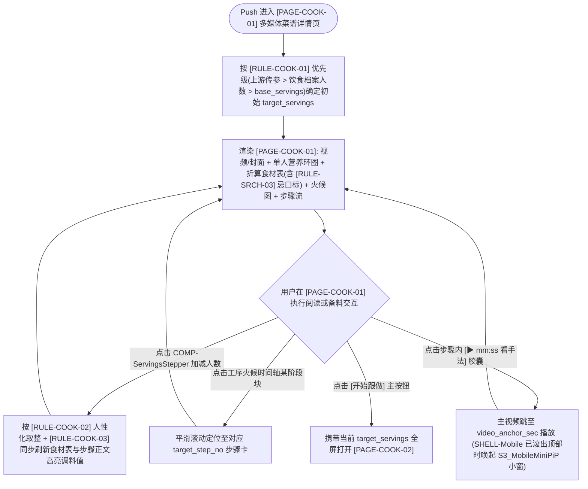
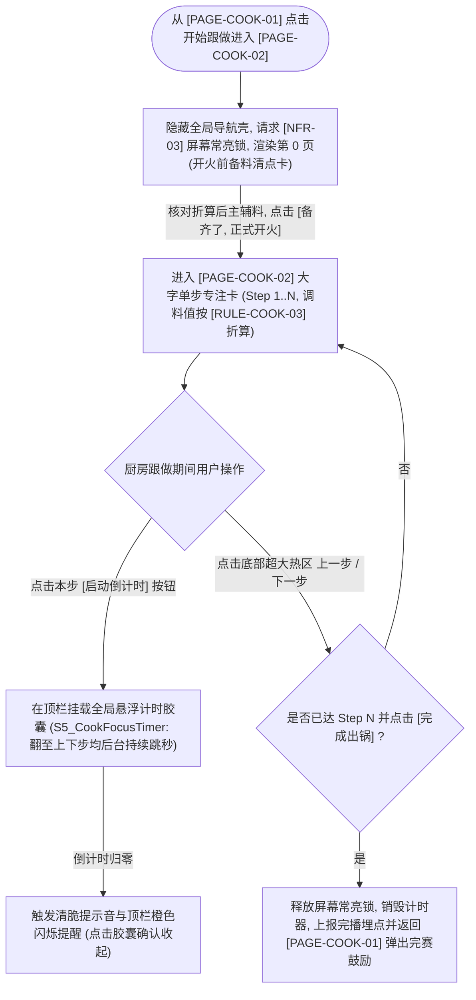

# 旅程阶段四：菜谱消费与实操跟做流程（`FLOW-COOK-*`）

## 1. `FLOW-COOK-01`：菜谱详情多媒体联动与动态分量换算流

- **1. 关联范围与前置条件**（Given）：
  - **支撑功能**：[FEAT-05](../../01-vision-and-scope.md#feat-05)
  - **涉及视图与规则**：[PAGE-COOK-01](../../06-pages/recipe-consumption/recipe-detail.md#page-cook-01)、[COMP-ServingsStepper](../../05-components-and-patterns/shared-components.md#comp-servingsstepper)、[RULE-COOK-01](../../03-business-rules/portion-and-cooking.md#rule-cook-01) ~ [RULE-COOK-03](../../03-business-rules/portion-and-cooking.md#rule-cook-03)、[RULE-SRCH-03](../../03-business-rules/search-and-matching.md#rule-srch-03)
  - **触发前置条件**：用户从 `PAGE-PLAN-01`、`PAGE-SRCH-01`、`PAGE-FAV-01` 或 `PAGE-PROF-01` 最近浏览足迹点击任一菜谱进入 `PAGE-COOK-01`。
- **2. 端到端交互与规则流转图**：

- **3. 中断与异常回退**：当处于弱网或离线环境导致教学视频流超时失败时，遵循 `PAT-ViewStates` 切换至 `S4_VideoDegraded`（回退高清静态封面海报 + `[重试视频]`），食材换算器、双图表与图文步骤保持 100% 正常交互不阻塞；手机端用户手动点击悬浮视频小窗 `✕` 关闭后，本次浏览下滑不再自动弹小窗打扰（除非再次主动点击步骤内的 `[▶ mm:ss 看手法]`）。
- **4. 跨页状态与缓存同步影响**：① 打开详情页时自动将该菜谱追加至本地/云端最近浏览历史队首（`PAGE-PROF-01` 可见，上限 20 条）；② **作用域严格隔离**：在详情页通过步进器调整的 `target_servings` 仅作用于本次 `PAGE-COOK-01` 与下游 `PAGE-COOK-02` 会话，**绝不反向污染** `DOM-USR-DietaryProfile.household_size` 或 `PAGE-PLAN-01` 今日三餐全局人数。

---

## 2. `FLOW-COOK-02`：全屏分步跟做与跨步骤悬浮倒计时完播流

- **1. 关联范围与前置条件**（Given）：
  - **支撑功能**：[FEAT-06](../../01-vision-and-scope.md#feat-06)
  - **涉及视图与约束**：[PAGE-COOK-01](../../06-pages/recipe-consumption/recipe-detail.md#page-cook-01)、[PAGE-COOK-02](../../06-pages/recipe-consumption/cooking-focus-mode.md#page-cook-02)、[NFR-03](../../01-vision-and-scope.md#nfr-03)、[RULE-COOK-02](../../03-business-rules/portion-and-cooking.md#rule-cook-02)、[RULE-COOK-03](../../03-business-rules/portion-and-cooking.md#rule-cook-03)
  - **触发前置条件**：用户在 `PAGE-COOK-01` 已确认用餐人数，点击底部或右侧栏的 `[🍳 开始跟做]` 按钮。
- **2. 端到端交互与规则流转图**：

- **3. 中断与异常回退**：① 若浏览器环境不支持系统级 `Screen Wake Lock API` 或电量过低被系统拒绝，顶栏常亮状态灯降级提示“请调长手机自动锁屏时间”，不阻断跟做流程；② 用户在中途点击右上角 `[退出跟做 ✕]` 时：若当前无运行中的倒计时则直接释放常亮锁返回 `PAGE-COOK-01`；若有正在跳秒的炖煮倒计时，轻提示确认“当前倒计时仍在运行，确认退出跟做吗？”防止误触中断掐表。
- **4. 跨页状态与缓存同步影响**：退出或完成 `PAGE-COOK-02` 返回宿主 `PAGE-COOK-01` 时，宿主详情页完整保留进入跟做前的 `target_servings` 折算人数与食材备料勾选态，并恢复外层视口对应的全局导航壳显隐状态。
