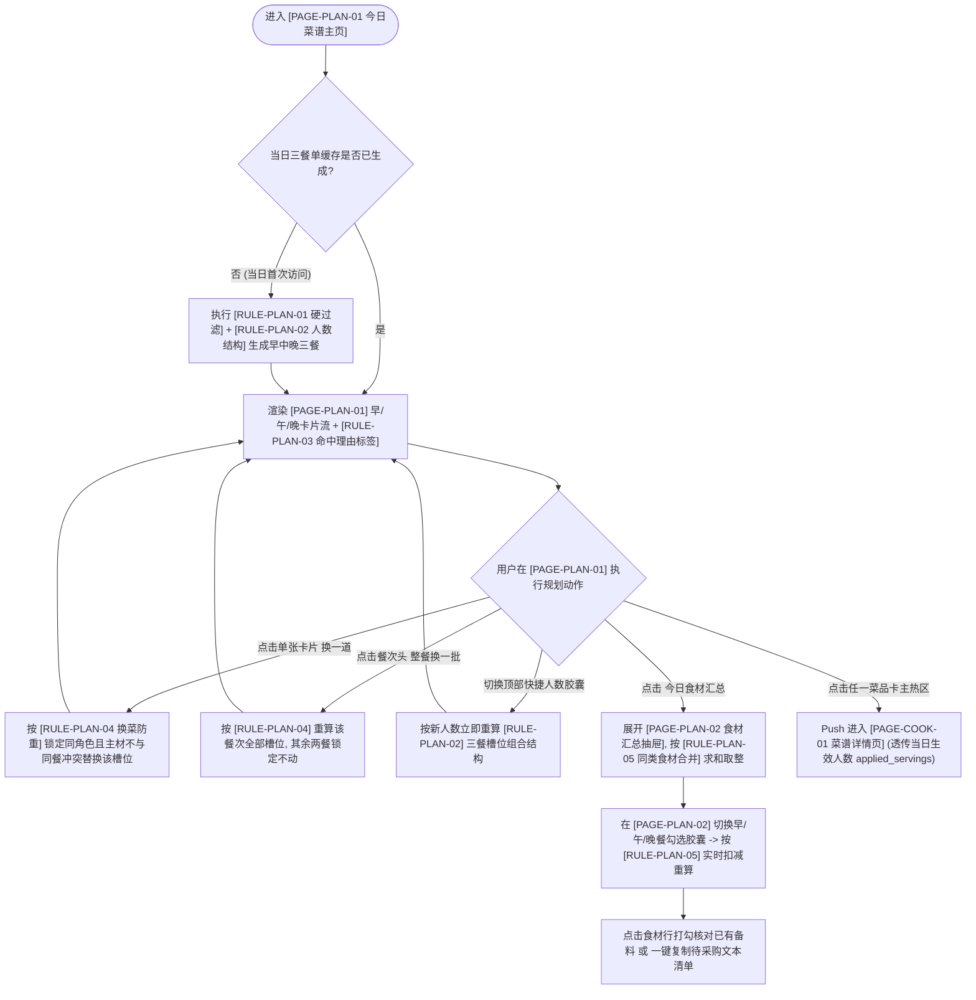
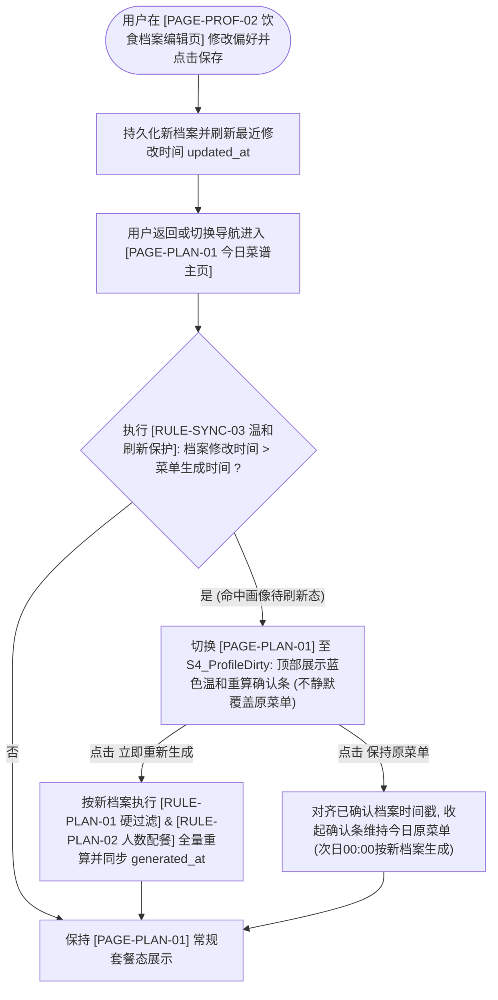

# 旅程阶段二：日常三餐规划与买菜核对流程（`FLOW-PLAN-*`）

## 1. `FLOW-PLAN-01`：今日三餐浏览、换菜与食材合并流

- **1. 关联范围与前置条件**（Given）：
  - **支撑功能**：[FEAT-02 个性化今日三餐智能配餐与换菜](../../01-vision-and-scope.md#feat-02)、[FEAT-03 今日三餐跨菜谱食材合并核对](../../01-vision-and-scope.md#feat-03)
  - **涉及视图与规则**（逐条展开）：
    - 视图：[PAGE-PLAN-01 今日菜谱主页](../../06-pages/daily-plan/daily-meal-plan.md#page-plan-01)、[PAGE-PLAN-02 今日食材汇总抽屉](../../06-pages/daily-plan/ingredient-summary-drawer.md#page-plan-02)、[PAGE-COOK-01 多媒体菜谱详情页](../../06-pages/recipe-consumption/recipe-detail.md#page-cook-01)
    - 规则：[RULE-PLAN-01 忌口厨具硬过滤否决](../../03-business-rules/meal-recommendation.md#rule-plan-01)、[RULE-PLAN-02 按人数配餐结构矩阵](../../03-business-rules/meal-recommendation.md#rule-plan-02)、[RULE-PLAN-03 推荐命中理由生成](../../03-business-rules/meal-recommendation.md#rule-plan-03)、[RULE-PLAN-04 单菜与整餐换一换互斥防重](../../03-business-rules/meal-recommendation.md#rule-plan-04)、[RULE-PLAN-05 跨菜谱同类食材合并](../../03-business-rules/meal-recommendation.md#rule-plan-05)
  - **触发前置条件**：用户进入应用默认首屏 `PAGE-PLAN-01`（无论已定制个人档案还是使用默认 2 人兜底参数）。
- **2. 端到端交互与规则流转图**：

- **3. 中断与异常回退**：单菜换一换若遇到候选池耗尽，按 `RULE-PLAN-04`（换菜互斥防重规则）自动清空该槽位历史已换掉黑名单（`dismissed_recipe_ids`）循环召回，并轻提示“已为你重新轮换精选菜式”；在汇总抽屉全部取消早/午/晚三餐勾选时，进入 `S6_EmptyMealSelected`（三餐全取消空态）引导而非报错白屏。
- **4. 跨页状态与缓存同步影响**：① 换菜或切换快捷人数后，当日 [DOM-PLN-DailyMealPlan 每日三餐单](../../02-domain-model/meal-and-collection/entities.md#dom-pln-dailymealplan) 缓存即时更新，再次打开 `PAGE-PLAN-02`（食材汇总抽屉）时自动基于最新菜品集合重新合并食材（同名标准食材保留当日已打勾的 `is_checked` 标记）；② 从推荐卡片点击进入 `PAGE-COOK-01`（菜谱详情页）时，当日生效人数（`applied_servings`）作为最高优先级初始人数透传完成详情折算。

---

## 2. `FLOW-PLAN-02`：修改饮食档案后的跨页温和重算闭环流

- **1. 关联范围与前置条件**（Given）：
  - **支撑功能**：[FEAT-01 渐进式饮食建档与注册登录一体化](../../01-vision-and-scope.md#feat-01)、[FEAT-02 个性化今日三餐智能配餐与换菜](../../01-vision-and-scope.md#feat-02)
  - **涉及视图与规则**：[PAGE-PROF-02 饮食档案编辑页](../../06-pages/user-profile/dietary-archive-editor.md#page-prof-02)、[PAGE-PLAN-01 今日菜谱主页](../../06-pages/daily-plan/daily-meal-plan.md#page-plan-01)、[RULE-SYNC-03 当日菜单温和刷新保护](../../03-business-rules/identity-and-sync.md#rule-sync-03)、[RULE-PLAN-01 忌口厨具硬过滤否决](../../03-business-rules/meal-recommendation.md#rule-plan-01)、[RULE-PLAN-02 按人数配餐结构矩阵](../../03-business-rules/meal-recommendation.md#rule-plan-02)
  - **配套可交互微原型**：[flow-profile-to-plan-sync.html](../../08-verification/prototypes/flows/flow-profile-to-plan-sync.html)
  - **触发前置条件**：当日 `PAGE-PLAN-01`（今日菜谱）已生成过有效三餐方案（菜单生成时间 `plan.generated_at` 非空），随后用户前往 `PAGE-PROF-02`（档案编辑页）修改了人数、辣度、忌口或厨具等任一字段并点击保存。
- **2. 端到端交互与规则流转图**：

- **3. 中断与异常回退**：若用户在 `PAGE-PROF-02`（档案编辑页）修改了表单但未点保存直接点击返回，弹出未保存变更放弃确认框；选择放弃后不更新最近修改时间（`updated_at`），回到今日菜谱不会误触发待刷新横幅。若用户对 `S4_ProfileDirty` 横幅暂不点击直接划走浏览菜谱，横幅在当日未表态前保持温和驻留，绝不阻断点击进入菜谱详情。
- **4. 跨页状态与缓存同步影响**：① [PAGE-PROF-01 个人中心主页](../../06-pages/user-profile/profile-home.md#page-prof-01) 饮食档案五维摘要与 [PAGE-SRCH-01 找菜谱主页](../../06-pages/recipe-discovery/recipe-search.md#page-srch-01) / [PAGE-COOK-01 菜谱详情页](../../06-pages/recipe-consumption/recipe-detail.md#page-cook-01) 的忌口预警标**无需等待确认、立即按新档案生效**；② 唯独今日菜谱当日已生成菜单受 `RULE-SYNC-03` 保护（防止用户早上买完菜下午改档案导致晚上找不到原菜谱），待用户点击“立即重新生成”或跨自然日 `00:00` 时再更新菜单与汇总抽屉数据源。
