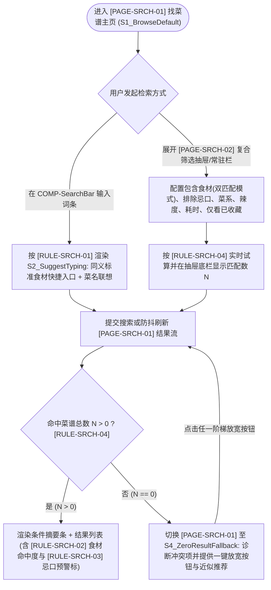
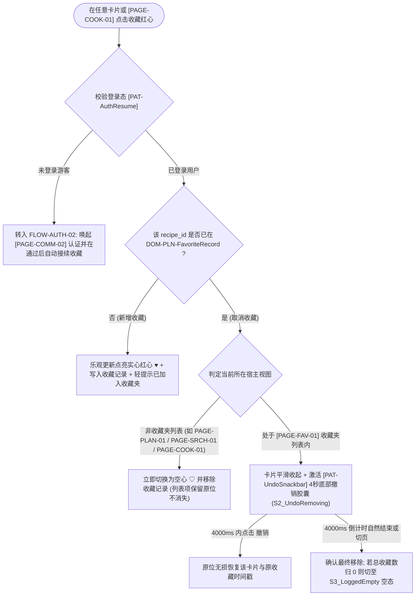

# 旅程阶段三：探索检索与收藏沉淀流程（`FLOW-DISC-*`）

## 1. `FLOW-DISC-01`：多维复合检索与零结果放宽兜底流

- **1. 关联范围与前置条件**（Given）：
  - **支撑功能**：[FEAT-04](../../01-vision-and-scope.md#feat-04)
  - **涉及视图与规则**：[PAGE-SRCH-01](../../06-pages/recipe-discovery/recipe-search.md#page-srch-01)、[PAGE-SRCH-02](../../06-pages/recipe-discovery/complex-filter-panel.md#page-srch-02)、[COMP-SearchBar](../../05-components-and-patterns/shared-components.md#comp-searchbar)、[RULE-SRCH-01](../../03-business-rules/search-and-matching.md#rule-srch-01) ~ [RULE-SRCH-04](../../03-business-rules/search-and-matching.md#rule-srch-04)
  - **触发前置条件**：用户进入一级导航 Tab 2 `PAGE-SRCH-01`（游客与登录用户均可直接使用）。
- **2. 端到端交互与规则流转图**：

- **3. 中断与异常回退**：在移动/平板端打开 `PAGE-SRCH-02` 调整了若干筛选项但未点击底部 `[查看匹配的 N 道菜谱]` 主按钮，而是直接点击遮罩或右上角 `✕` 收起抽屉时，本次抽屉内未提交的临时勾选回退至打开前已生效的筛选集合（Web 桌面端因内嵌常驻无确认按钮，每次勾选经 `250ms` 防抖后直接生效）。
- **4. 跨页状态与缓存同步影响**：提交有效关键词后自动写入本地最近搜索历史（最多保留 10 条去重记录）；`PAGE-SRCH-01` 与 `PAGE-SRCH-02` 的筛选状态在跨一级 Tab 切换期间全程 Keep-Alive 保活，直至用户点击 `[清空全部]`；点击结果卡片进入 `PAGE-COOK-01` 再返回时保留原列表筛选态与滚动位置。

---

## 2. `FLOW-DISC-02`：轻量单层收藏与 4 秒误触撤销保护流

- **1. 关联范围与前置条件**（Given）：
  - **支撑功能**：[FEAT-07](../../01-vision-and-scope.md#feat-07)
  - **涉及视图与契约**：[PAGE-FAV-01](../../06-pages/favorites/favorites-list.md#page-fav-01)、[PAGE-COOK-01](../../06-pages/recipe-consumption/recipe-detail.md#page-cook-01)、[COMP-RecipeCard](../../05-components-and-patterns/shared-components.md#comp-recipecard)、[PAT-AuthResume](../../05-components-and-patterns/interaction-patterns.md#pat-authresume)、[PAT-UndoSnackbar](../../05-components-and-patterns/interaction-patterns.md#pat-undosnackbar)
  - **触发前置条件**：用户在全站任意 `COMP-RecipeCard` 右上角或 `PAGE-COOK-01` 操作栏点击红心收藏按钮。
- **2. 端到端交互与规则流转图**：

- **3. 中断与异常回退**：新增或取消收藏采用前端乐观更新（Optimistic UI），若后台持久化接口因断网报错，立即回滚红心点亮状态或重现刚收起的卡片，并弹出重试提示“网络开小差，收藏操作未保存”。
- **4. 跨页状态与缓存同步影响**：全站所有挂载 `COMP-RecipeCard` 的保活页面（`PAGE-PLAN-01`、`PAGE-SRCH-01`、`PAGE-FAV-01`）、`PAGE-COOK-01` 详情收藏按钮及 `PAGE-PROF-01` 账号卡收藏计数均订阅同一份内存收藏索引映射表，任一处增删收藏后跨页面 `0` 延迟即时同步。
