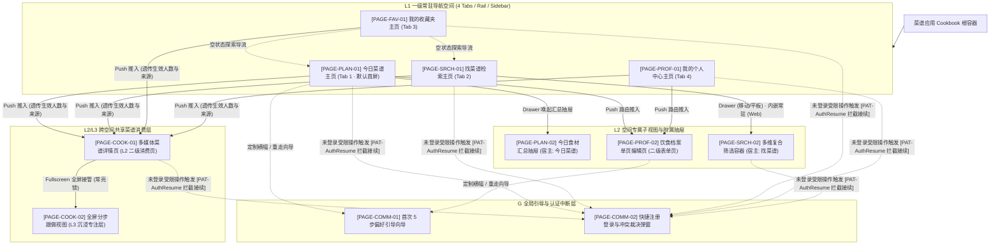

# 04-1. 全局信息架构与多端响应式容器壳（IA & Responsive Shell）

本文档遵循元规范 [03-authoring-templates.md 第 2.4.1 节](../../meta/03-authoring-templates.md#tpl-ia-shell)，统一定义全站 **11 个独立视图单元的层级拓扑、一级导航保活与回退契约**，以及响应 [NFR-01 Mobile-First 全端响应式一致性](../01-vision-and-scope.md#nfr-01) 的**三端视口容器壳、标准分栏骨架、外框退化与次级浮层叠放规范**。

---

## 1. 全局导航拓扑与路由栈契约（Global IA & Routing Contract）

### 1.1 拓扑建模粒度边界与分层说明

- **建模颗粒度红线**：本图仅纳入在 [06-pages 页面总注册表](../06-pages/_index.md) 独立注册 `PAGE-*` 编号的页面级载体、复杂附属抽屉/面板、全屏专注覆盖层及全局模态弹窗；单页内部的局部区块、餐次锚点、轻提示 Toast 及简单二次确认框均收敛于对应单页文档内部，不在此下钻展开。
- **四层职责分区**：全站由 **4 个 L1 一级常驻导航空间**承载日常高频入口，搭配 **3 个 L2 空间专属附属视图**、**2 个跨空间共享消费视图**与 **2 个 G 全局引导/认证中断层**，所有核心下厨任务均在 `<= 2` 次路由跳转内可达。



### 1.2 一级导航席位注册与保活契约表

| 席位序号 | 导航标准文案 | 绑定根页面 | 默认首屏 | 角标 / 状态指示规则 | 游客态可达性（先逛后登准则） | 切换保活（Keep-Alive）与激活态重按行为 |
| :--- | :--- | :--- | :--- | :--- | :--- | :--- |
| **Tab 1** | 今日菜谱 | [PAGE-PLAN-01 今日菜谱主页](../06-pages/daily-plan/daily-meal-plan.md#page-plan-01) | **是** | 导航图标无红点打扰；档案变更待刷新统一通过页内温和横幅提示 | 直接进入，未建档渲染默认 2 人时令套餐与定制横幅 | 切换保留当日已生成菜单、餐次锚点与滚动位；激活态重按平滑回顶（不强制重算覆盖） |
| **Tab 2** | 找菜谱 | [PAGE-SRCH-01 找菜谱检索主页](../06-pages/recipe-discovery/recipe-search.md#page-srch-01) | 否 | 无导航角标（已启用筛选项计数展示在页内筛选按钮上） | 直接进入并支持关键词与多食材复合检索 | 切换完整保留输入框词条、已勾选筛选集合与结果流滚动偏移；激活态重按回顶并聚焦搜索框 |
| **Tab 3** | 收藏夹 | [PAGE-FAV-01 我的收藏夹主页](../06-pages/favorites/favorites-list.md#page-fav-01) | 否 | 无数字红点 | **允许直接切入**展示跨端收藏价值引导空态（**严禁**点击 Tab 时粗暴拦截弹登录框） | 切换保留页内快筛词与配餐角色胶囊选中态；激活态重按平滑回顶 |
| **Tab 4** | 我的 | [PAGE-PROF-01 个人中心主页](../06-pages/user-profile/profile-home.md#page-prof-01) | 否 | 游客有本地偏好草稿时，页内身份卡显式标注“本地草稿未同步” | 直接进入，可查看/编辑本地饮食档案与最近浏览记录 | 切换保留滚动位置；激活态重按平滑回顶 |

### 1.3 路由历史栈回退与深链（Deep-Link）直达兜底规则

| 路由流转场景 | 历史栈与参数传递规则 | 无站内历史栈（外链直达 / 浏览器强刷）兜底回退页 |
| :--- | :--- | :--- |
| 进入二级详情页 [PAGE-COOK-01 多媒体菜谱详情](../06-pages/recipe-consumption/recipe-detail.md#page-cook-01) | 标准 `Push` 入栈，携带入口来源（`entry_source`）与上游生效人数；点击返回执行 `Pop` 退回原来源列表页并恢复原滚动坐标 | 兜底回退至 [PAGE-PLAN-01 今日菜谱主页](../06-pages/daily-plan/daily-meal-plan.md#page-plan-01) |
| 进入档案编辑页 [PAGE-PROF-02 饮食档案编辑](../06-pages/user-profile/dietary-archive-editor.md#page-prof-02) | 从今日菜谱或个人中心 `Push` 入栈；保存或取消后原路 `Pop` 返回触发来源页 | 兜底回退至 [PAGE-PROF-01 个人中心主页](../06-pages/user-profile/profile-home.md#page-prof-01) |
| 展开附属抽屉 / 专注层（[PAGE-PLAN-02 食材汇总](../06-pages/daily-plan/ingredient-summary-drawer.md#page-plan-02) / [PAGE-SRCH-02 复合筛选](../06-pages/recipe-discovery/complex-filter-panel.md#page-srch-02) / [PAGE-COOK-02 全屏跟做](../06-pages/recipe-consumption/cooking-focus-mode.md#page-cook-02)） | 挂载于宿主页面之上，宿主 DOM 与内存态保持存活不销毁；支持移动端系统侧滑返回键优先关闭当前顶层抽屉/覆盖层 | URL 直接命中子视图路由时，自动先初始化挂载对应宿主主页面再展开该子层 |

---

## 2. 多端视口断点、画布栅格与导航壳基线表（`SHELL-*` Master Baseline）

全站定义三套标准响应式视口容器壳，供所有 `06-pages/` 单页规格书第 2 节引用及 `07` 埋点公共属性视口标识（`viewport_shell`）采集：

| 容器壳 ID | 视口断点与设计基准宽 | 典型下厨场景与输入特征 | 画布版心、安全边距与栅格基线 | 一级导航栏形态与尺寸契约 |
| :--- | :--- | :--- | :--- | :--- |
| <a id="shell-mobile"></a>**SHELL-Mobile** | `< 768px`<br>（设计基准 `390px`，最小兼容 `320px`） | 地铁通勤单手选餐、超市单手核对买菜、手机竖支灶台速看；拇指单手触控热区 | 流式 `100%` 宽 · 左右安全边距 `16px` · **4 列栅格**（槽宽 `12px`）· 顶底避让系统安全区 `env(safe-area-inset-*)` | **底部固定 4-Tab 栏**（净高 `60px` + 底部系统安全区，顶边 `1px` 分割线，图标居上 + `11px` 标签居下） |
| <a id="shell-tablet"></a>**SHELL-Tablet** | `768px ~ 1023px`<br>（设计基准 `834px / 920px` 横屏优先） | 平板横立于厨房料理台面，视距 `50~70cm`，备菜湿手点按，“边看视频备料边看步骤” | 自适应满幅（扣除左导航轨宽）· 左右主边距 `24px` · **8 列栅格**（槽宽 `16px`） | **左侧常驻紧凑窄导航轨 Navigation Rail**（固定宽 `76px`，全高 `100dvh`，纵向排布图标 + `11px` 短文案，零纵向高度损耗） |
| <a id="shell-desktop"></a>**SHELL-Desktop** | `>= 1024px`<br>（设计基准 `1280px / 1440px`） | 桌面浏览器宽屏深度检索菜谱、整理收藏与集中规划周末家庭采购；键鼠精准交互与滚轮 | 右侧主工作区流式铺满，阅读容器 **`max-width: 1200px` 水平居中** · 左右边距 `28~32px` · **12 列栅格**（槽宽 `24px`） | **左侧常驻展开式导航侧栏 Sidebar**（固定宽 `220px`，全高 `100dvh`，顶部含产品品牌头，导航项采用图标 + `14px` 横向完整名称） |

---

## 3. 容器壳插槽解剖、标准分栏骨架与外框退化规则

### 3.1 三端容器壳物理插槽结构示意（Shell Slot Anatomy）

三端容器壳由统一的语义化插槽（`Slot-*`）重组变形，各单页业务区块只允许挂载进主画布或专属操作槽，无需重复绘制全局导航栏：

```text
[SHELL-Mobile (<768px)]             [SHELL-Tablet (768~1023px)]               [SHELL-Desktop (>=1024px)]
+--------------------------+        +-------+-------------------------------+ +----------+-----------+------------------------+
| [Slot-Header] 吸顶页头/返回|        |       | [Slot-Header] 内联页头/返回条  | |          | [SubSide] | [Slot-Header] 页头栏    |
+--------------------------+        | [Slot |-------------------------------| |  [Slot   | 空间级常驻 |------------------------|
|                          |        | -Nav] |               |               | |  -Nav]   | 内嵌过滤栏 | [Slot-Main] | [Aside]  |
|       [Slot-Main]        |        | 左侧窄 |  [Slot-Main]  | [Slot-Aside]  | | 左侧展开  | (280px,   | 核心主内容流 | 右吸顶   |
|     单栏纵向主滚动区       |        | 导航轨 |  主滚动区/左栏 | 独立滚动/吸顶栏| | 导航侧栏  |  按需挂载) | (max 1200px | 工具副栏 |
|               [Float小窗] |        | (76px)|               |               | | (220px)  |           |   居中容器)  | (Sticky) |
+--------------------------+        |       |       [Slot-Float 轻提示区]    | |          |           |     [Slot-Float 区]    |
| [Slot-Nav 60px] 或 [吸底栏]|        +-------+-------------------------------+ +----------+-----------+------------------------+
+--------------------------+
```

### 3.2 主画布（`Slot-Main`）四套标准内容分栏骨架

为避免将单一页面的私有排版硬编码进全局容器壳，本节抽象全站通用的 **4 套标准响应式分栏骨架**，供 `06-pages/` 各页第 2 节按名挂载：

| 骨架编码 | 适用业务视图特征 | `SHELL-Mobile` 排布规则 | `SHELL-Tablet` 排布规则 | `SHELL-Desktop` 排布规则 | 下游挂载页面 |
| :--- | :--- | :--- | :--- | :--- | :--- |
| <a id="mode-cardgrid"></a>**Mode-CardGrid** | 多菜谱浏览与分组推荐卡片流 | `1` 列纵向卡片流（间距 `10px`） | `2` 列等宽网格（`gap: 14px`） | `3` 列宽幅卡片网格（`gap: 18px`） | [PAGE-PLAN-01 今日菜谱](../06-pages/daily-plan/daily-meal-plan.md#page-plan-01)、[PAGE-FAV-01 收藏夹](../06-pages/favorites/favorites-list.md#page-fav-01) |
| <a id="mode-filterworkspace"></a>**Mode-FilterWorkspace** | 高频多维条件过滤 + 实时结果流 | 吸顶搜索与胶囊栏 + `1` 列结果流（过滤面板收拢为底部抽屉） | 吸顶搜索栏 + `2` 列结果网格（过滤面板收拢为右侧抽屉） | 激活左侧 `[Slot-SubSide]` **常驻内嵌筛选栏**（宽 `280px`）+ 右侧 `2~3` 列结果网格（勾选实时刷新） | [PAGE-SRCH-01 找菜谱主页](../06-pages/recipe-discovery/recipe-search.md#page-srch-01) + [PAGE-SRCH-02 复合筛选](../06-pages/recipe-discovery/complex-filter-panel.md#page-srch-02) |
| <a id="mode-splitdetail"></a>**Mode-SplitDetail** | 富媒体阅读核对与主从双块并列 | 单栏纵向流 + 底部吸底操作栏（视频滚出视口时右上角挂载 Mini-PiP 小窗） | **左右双栏独立滚动/吸顶**（详情页左 `42%` Sticky 备料视频 + 右 `58%` 步骤流；个人中心左身份设置 + 右档案摘要） | **主副双栏**（详情页左宽主栏 `64%` + 右 Sticky 吸顶换算栏 `36%`；个人中心居中双栏） | [PAGE-COOK-01 菜谱详情页](../06-pages/recipe-consumption/recipe-detail.md#page-cook-01)、[PAGE-PROF-01 个人中心](../06-pages/user-profile/profile-home.md#page-prof-01) |
| <a id="mode-focusedform"></a>**Mode-FocusedForm** | 多分组表单编辑或沉浸单步大卡 | `100%` 全宽单栏流 + 底部固定主行动栏 | 居中限宽容器（表单宽 `<= 760px`；跟做页左图右大字宽卡） | 居中限宽容器（表单 `max-width: 820px` 锚点定位；跟做页宽屏双区大卡 `max-width: 960px`） | [PAGE-PROF-02 档案编辑页](../06-pages/user-profile/dietary-archive-editor.md#page-prof-02)、[PAGE-COOK-02 全屏跟做](../06-pages/recipe-consumption/cooking-focus-mode.md#page-cook-02) |

### 3.3 视图深度与全局外框显隐退化矩阵（Chrome Visibility by View Depth）

| 视图层级深度 | 代表页面（点击直达） | `SHELL-Mobile` 外框显隐与迁移 | `SHELL-Tablet` 外框显隐与迁移 | `SHELL-Desktop` 外框显隐与迁移 |
| :--- | :--- | :--- | :--- | :--- |
| **L1 一级导航根页** | [PAGE-PLAN-01 今日菜谱](../06-pages/daily-plan/daily-meal-plan.md#page-plan-01)、[PAGE-SRCH-01 找菜谱](../06-pages/recipe-discovery/recipe-search.md#page-srch-01)、[PAGE-FAV-01 收藏夹](../06-pages/favorites/favorites-list.md#page-fav-01)、[PAGE-PROF-01 个人中心](../06-pages/user-profile/profile-home.md#page-prof-01) | 底部 `60px` 4-Tab 栏常驻可见；无返回箭头 | 左侧 `76px` Navigation Rail 常驻可见 | 左侧 `220px` Sidebar 常驻可见 |
| **L2 二级标准推入页** | [PAGE-COOK-01 菜谱详情](../06-pages/recipe-consumption/recipe-detail.md#page-cook-01)、[PAGE-PROF-02 档案编辑](../06-pages/user-profile/dietary-archive-editor.md#page-prof-02) | **隐藏底部 4-Tab 栏**释放纵向高度；顶部挂载吸顶 `[← 返回 + 标题]`，底部挂载页面专属吸底操作栏 `[Slot-BottomBar]` | **保留左侧 `76px` 导航轨常驻**（支持一键跨空间跳转）；主区顶栏内联渲染 `[← 返回]`，原手机吸底动作收敛进吸顶副栏或表单底栏 | **保留左侧 `220px` 侧栏常驻**；版心顶部渲染 `[← 返回上级]` 面包屑条，主操作收敛进右侧 `36%` 吸顶栏或表单底栏 |
| **L3 全屏沉浸专注层** | [PAGE-COOK-02 全屏分步跟做](../06-pages/recipe-consumption/cooking-focus-mode.md#page-cook-02) | **隐藏全部全局导航壳**，接管 `100vw × 100dvh` 深色常亮画布（遵循 [NFR-03 厨房防油污易用性](../01-vision-and-scope.md#nfr-03)），顶栏固定常亮灯+计时胶囊+`[退出 ✕]`，底栏固定 `>= 52px` 翻页热区 | **隐藏左侧 `76px` 导航轨**，全视口深色沉浸画布，保持与手机一致的防息屏顶栏与超大翻页底栏 | **隐藏左侧 `220px` 侧栏**，全视口深色高对比专注画布，支持键盘 `← / →` 方向键快捷翻步与 `Esc` 退出 |

---

## 4. 次级容器跨端变形与 Z 轴叠放契约（Overlay Adaptation & Z-Index）

### 4.1 五类次级容器三端自适应变形矩阵

| 次级容器类别 | 挂载实例 | `SHELL-Mobile` 形态与尺寸 | `SHELL-Tablet` 形态与尺寸 | `SHELL-Desktop` 形态与尺寸 | 遮罩锁滚与关闭交互契约 |
| :--- | :--- | :--- | :--- | :--- | :--- |
| **1. 高频复合过滤容器** | [PAGE-SRCH-02 复合筛选容器](../06-pages/recipe-discovery/complex-filter-panel.md#page-srch-02) | **底部模态抽屉 Bottom Sheet**（`max-height: 85vh`，顶部圆角 `16px`，底部固定重置+实时计数主按钮） | **右侧滑出模态抽屉 Side Drawer**（固定宽 `380px`，高 `100dvh`，底部固定重置+确认按钮） | **降维内嵌为左侧常驻栏**（宽 `280px`，无遮罩非模态，隐藏确认关闭按钮，勾选实时防抖刷新列表） | 移动/平板端开启半透明遮罩并锁定宿主滚动，支持点遮罩或 `✕` 收起；Web 端常驻不关闭 |
| **2. 对照核对侧滑抽屉** | [PAGE-PLAN-02 今日食材汇总抽屉](../06-pages/daily-plan/ingredient-summary-drawer.md#page-plan-02) | **底部模态抽屉 Bottom Sheet**（`max-height: 85vh`，支持内部列表独立滚动） | **右侧滑出抽屉 Side Drawer**（宽 `420px`，高 `100dvh`，左侧露出部分菜单供对照） | **右侧滑出抽屉 Side Drawer**（宽 `420px`，高 `100dvh`，对照左侧三餐卡片核对） | 开启遮罩锁定底层列表滚动；支持点击遮罩、`[完成核对]`、`✕` 或桌面 `Esc` 键收起 |
| **3. 轻量表单与认证弹窗** | [PAGE-COMM-02 快捷认证弹窗](../06-pages/common-and-onboarding/auth-modal.md#page-comm-02) | **底部圆角抽屉 Bottom Sheet**（内容自适应高，系统软键盘弹起时自动上推输入框防遮挡） | **屏幕居中模态框 Centered Modal**（固定宽 `420px`，圆角 `14px`） | **屏幕居中模态框 Centered Modal**（固定宽 `420px`，支持 `Esc` 键关闭） | 拦截唤起时暂存挂起意图（`pendingAction`）；主动点遮罩或 `✕` 取消时清空挂起动作，宿主页面保持原貌 |
| **4. 多步沉浸引导向导** | [PAGE-COMM-01 5步偏好引导向导](../06-pages/common-and-onboarding/onboarding-wizard.md#page-comm-01) | **全屏沉浸卡片**（`100vw × 100dvh`，吸顶进度条+跳过，中部滚动，吸底上/下一步） | **屏幕居中大模态窗 Centered Modal**（宽 `560px`，`max-height: 82vh`） | **屏幕居中大模态窗 Centered Modal**（宽 `560px`，`max-height: 82vh`） | **禁用点击遮罩直接关闭**（防止误触丢失已填步骤），仅允许通过右上角 `[跳过先逛]` 或完成第 5 步退出 |
| **5. 非阻塞悬浮层与轻提示** | [PAT-UndoSnackbar 4秒延迟撤销条](../05-components-and-patterns/interaction-patterns.md#pat-undosnackbar)、详情悬浮视频小窗 | • **Snackbar**：底边锚定于导航栏/吸底栏正上方（`bottom: 68px + safe-area`）<br>• **Mini-PiP**：右上角吸附（宽 `148px`，`16:9`，带 `✕` 关闭钮） | • **Snackbar**：主画布水平居中、`bottom: 24px`<br>• **Mini-PiP**：不启用（左栏视频已 Sticky 常驻） | • **Snackbar**：主工作区水平居中、`bottom: 28px`<br>• **Mini-PiP**：不启用（宽屏主栏无需悬浮小窗） | 零遮罩非模态，绝不阻断底层滚动与点击；Snackbar 驻留 `4000ms` 自动消散 |

### 4.2 全局 Z-Index 叠放梯队与防遮挡契约

为根治“在筛选抽屉内触发登录框时弹窗被抽屉遮挡”及“底部撤销条被导航栏盖住”等常见多层嵌套缺陷，全站强制执行以下 7 级叠放次序：

| 叠放梯队编码 | 建议基准值 | 承载视图或浮层元素 | 多层并发与安全避让硬性约束 |
| :--- | :--- | :--- | :--- |
| **Z10 · BaseCanvas** | `1` | 主画布常规文档流（`[Slot-Main]` / `[Slot-SubSide]`） | 默认基准层 |
| **Z20 · StickyChrome** | `20` | 页内吸顶搜索栏、餐次吸顶条、平板/桌面 Sticky 副栏、L2 吸底操作栏 | 仅在所属滚动容器内吸顶/吸底，不得遮挡全局导航壳 |
| **Z30 · InPageFloat** | `30` | 手机详情页右上角悬浮视频小窗（Mini-PiP） | 浮于详情步骤正文之上，但打开任何模态框或进入 `PAGE-COOK-02`（全屏跟做）时必须自动暂停隐藏 |
| **Z40 · GlobalNav** | `40` | 一级导航壳（手机底部 4-Tab 栏 / 平板 Rail / 桌面 Sidebar） | 常驻高于页面滚动内容与页内 Sticky 栏 |
| **Z50 · BusinessOverlay** | `60` | 空间业务抽屉与引导向导（`PAGE-PLAN-02`、`PAGE-SRCH-02` 移动/平板态、`PAGE-COMM-01`）及全屏专注层（`PAGE-COOK-02`） | 完整覆盖 `Z40` 全局导航栏，附带半透明遮罩层 |
| **Z60 · AuthInterceptor** | `80` | 全局认证与档案裁决弹窗（`PAGE-COMM-02`） | **必须高于 `Z50` 业务抽屉**：当游客在已展开的 `PAGE-SRCH-02`（复合筛选抽屉）内开启“仅看已收藏”时，`PAGE-COMM-02` 直接叠放在筛选抽屉正上方；认证完成后仅关闭 `Z60`，原 `Z50` 筛选抽屉保持展开并自动开启开关 |
| **Z70 · TransientFeedback** | `100` | 全局 4 秒撤销胶囊（`PAT-UndoSnackbar`）与操作结果轻提示（Toast） | 全站最高可视层；在 `SHELL-Mobile` 一级页中底部偏移须 `>= 68px` 以避让 `Z40` 底部 Tab 栏 |
