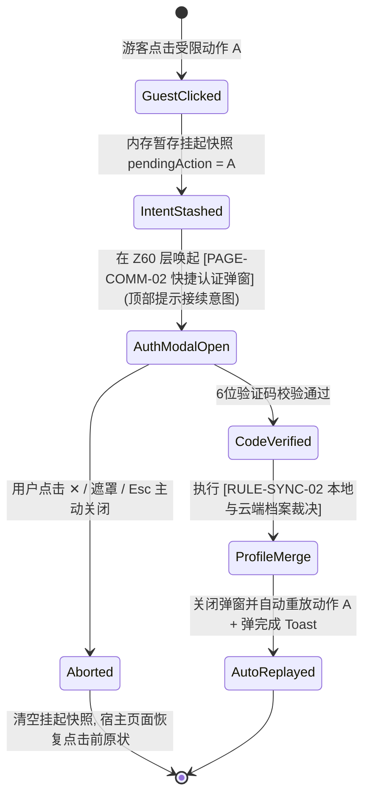
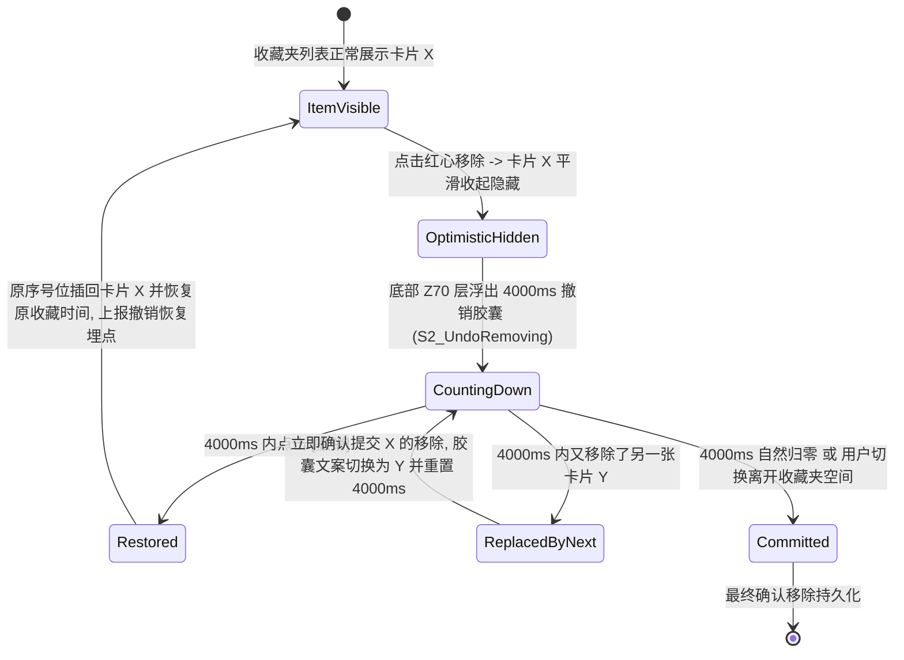
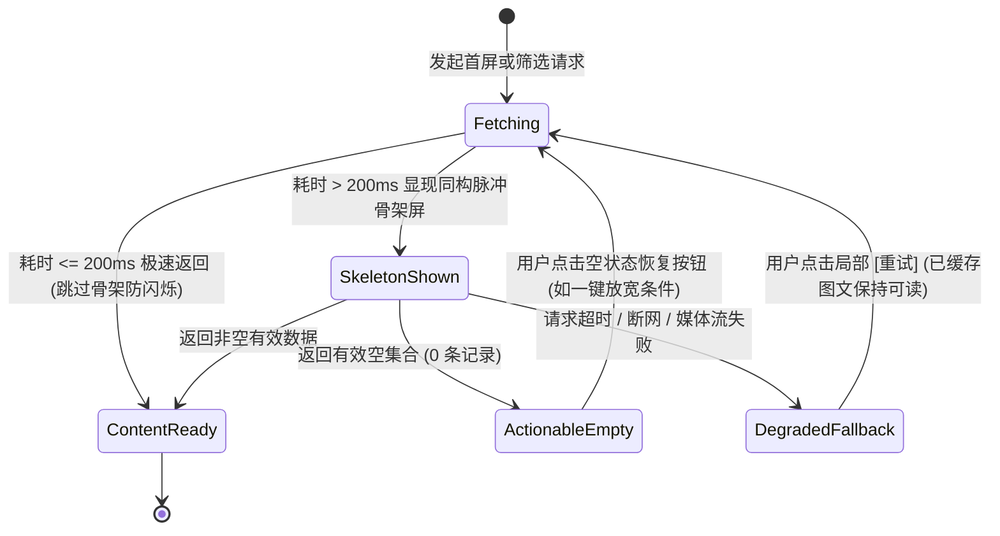

# 05-2. 全局通用交互模式契约（`PAT-*`）

本文档严格遵循元规范 [03-authoring-templates.md 第 2.5.2 节](../../meta/03-authoring-templates.md#tpl-pat-doc) 的**固定四段式结构**，定义贯穿全站的受限动作鉴权接续、防误删延迟撤销与视图异常降级三大交互状态机。

---

## 1. `PAT-AuthResume`（受限操作登录拦截与自动接续模式）

### 1.1 适用触发范围与设计原则
- **适用范围**：未登录游客（`auth_state == 'guest'`）触发全站任一强账号绑定动作时，包括：① 点击任意 [COMP-RecipeCard 菜谱卡片](./shared-components.md#comp-recipecard) 或 [PAGE-COOK-01 菜谱详情页](../06-pages/recipe-consumption/recipe-detail.md#page-cook-01) 的红心收藏；② 在 [PAGE-SRCH-01 找菜谱主页](../06-pages/recipe-discovery/recipe-search.md#page-srch-01) 或 [PAGE-SRCH-02 复合筛选面板](../06-pages/recipe-discovery/complex-filter-panel.md#page-srch-02) 开启“仅看已收藏”开关；③ 在 [PAGE-PROF-01 个人中心主页](../06-pages/user-profile/profile-home.md#page-prof-01) 点击“登录以永久跨端保存”。
- **核心设计原则**：坚持“先逛后登不设墙”；一旦游客因某个明确操作意图完成认证，系统**必须自动代为执行刚才被挂起的原动作**，严禁仅关闭弹窗让用户手动再点第二次。

### 1.2 标准状态迁移图

### 1.3 时序参数与多端表现契约表

| 契约维度 / 阶段 | 量化参数与作用域 | 界面视觉与叠放表现 | 底层状态读写要求 |
| :--- | :--- | :--- | :--- |
| **意图暂存快照** | 仅存活于当前前端内存会话（不落盘本地存储） | 原触发控件保持未选中态（不提前假点亮红心） | 记录动作类型、目标菜谱 ID 与触发宿主页面编码（`{ actionType, targetRecipeId?, hostPageId }`） |
| **认证框叠放与提示** | 挂载于 [04-1 容器壳叠放契约](../04-ia-and-flows/ia-and-shell.md) 的 `Z60` 层 | 弹窗顶部显著展示上下文横幅（如 `验证后将自动为你收藏这道菜`） | 若从 `Z50` 筛选抽屉内唤起，底层筛选抽屉保持展开不销毁 |
| **认证后自动接续** | 档案裁决完成后 `<= 150ms` 内自动触发 | 原位点亮红心或激活“仅看已收藏”过滤列表，伴随顶部/底部成功轻提示 | 消费成功后立即清空挂起快照（`pendingAction = null`）防止重复重放 |

### 1.4 并发冲突、中断与异常恢复边界表

| 异常或并发边界场景 | 系统确定性裁决与恢复行为 | 严禁出现的体验反例 |
| :--- | :--- | :--- |
| 游客点收藏弹登录框后，未验证直接点 `✕` 或遮罩关闭 | 立即销毁挂起意图（`pendingAction`），原卡片红心保持空心 `♡`，列表滚动位不变 | 关闭后残留旧意图，导致用户稍后去个人中心单纯点登录时莫名自动收藏刚才的菜 |
| 游客点击收藏某菜谱，登录老账号后发现该老账号历史**早已收藏过**该菜谱 | 幂等判定为“已在收藏夹”，直接渲染实心红心 `♥` 并提示“已同步账号收藏状态”，**严禁**误执行反向取消收藏 | 死板调用反转接口（`toggle`）导致把老账号原本已收藏的菜反而取消掉 |
| 在复合筛选抽屉内点“仅看收藏”并完成登录后，该账号云端收藏数为 `0` | 自动开启“仅看已收藏”开关，列表按 [RULE-SRCH-04 复合布尔与零结果放宽规则](../03-business-rules/search-and-matching.md#rule-srch-04) 正常进入零结果态（`S4_ZeroResultFallback`）并提供 `[关闭仅看收藏]` 一键恢复按钮 | 静默吞掉用户的开关意图或发生空指针报错 |

---

## 2. `PAT-UndoSnackbar`（破坏性列表移除 4 秒撤销保护模式）

### 2.1 适用触发范围与设计原则
- **适用范围**：在 [PAGE-FAV-01 我的收藏夹](../06-pages/favorites/favorites-list.md#page-fav-01) 列表内点击实心红心移除菜谱等“点击后目标元素会立即从当前视图消失”的操作（注：在推荐页/搜索页/详情页取消收藏因菜谱仍留在原位可随时再点红心，故直接切换空心图标，不弹撤销条）。
- **核心设计原则**：用“即时响应 + 事后可悔改”替代打断心流的模态二次确认框（`确定取消收藏吗？`）。

### 2.2 标准状态迁移图

### 2.3 时序参数与多端表现契约表

| 契约维度 / 阶段 | 量化阈值与时序参数 | 界面视觉与多端避让位置 | 底层状态读写要求 |
| :--- | :--- | :--- | :--- |
| **列表项收起过渡** | 高度折叠动画 `180ms` | 下方相邻卡片平滑上移填补空位，页头收藏计数同步 `-1` | 内存中将该项移入待删除槽位，保留原排序序号与原收藏时间戳（`favorited_at`） |
| **悬浮胶囊驻留与定位** | 精确驻留 **`4000ms`**（桌面鼠标悬停于胶囊上时暂停倒计时） | 深灰黑底圆角胶囊：`已将「{10字内截断菜名}」移出收藏夹 [撤销]`；手机端锚定 `bottom: 68px + safe-area` 避让底部 Tab 栏，平板/桌面端锚定主区底部 `24~28px` | 挂载于全站最高 `Z70` 层 |
| **点击 `[撤销]` 恢复** | 响应延迟 `< 50ms` | 胶囊立即消失，卡片滑入回原列表序号位置（绝不粗暴插到队首打乱顺序），计数 `+1` | 恢复原记录并上报 [EVT-12 收藏增删与撤销埋点](../07-metrics-and-tracking/event-dictionary.md#evt-12)（`action='undo_restore'`） |

### 2.4 并发冲突、中断与异常恢复边界表

| 异常或并发边界场景 | 系统确定性裁决与恢复行为 | 严禁出现的体验反例 |
| :--- | :--- | :--- |
| `4000ms` 内连续快速取消了菜谱 A 与菜谱 B 的收藏 | 单例替换策略：点击 B 的瞬间立即确认提交 A 的最终删除，底部始终只保留 **1 条**最新针对 B 的 `4000ms` 撤销胶囊 | 屏幕底部纵向叠罗汉堆出三四条黑条遮挡列表 |
| 移除收藏夹中**最后仅剩的 1 道菜** | 列表立即转入 0 收藏引导空态（`S3_LoggedEmpty`），但底部 `4000ms` 撤销胶囊**依然保留展示**；点撤销可从空状态一键恢复回正常列表态（`S1_LoggedWithItems`） | 因触发空状态重渲染把底部撤销胶囊一并销毁，导致最后一道菜误删无法反悔 |
| 倒计时未结束时用户点击底部导航切换去其他 Tab | 离开收藏夹主页时立即确认提交挂起删除并收起该页专属撤销胶囊 | 切去“个人中心”后底部还挂着莫名其妙的收藏撤销条 |

---

## 3. `PAT-ViewStates`（全局视图加载、空态、降级与反馈四态契约）

### 3.1 适用触发范围与设计原则
- **适用范围**：全站全部 `11` 个视图的数据初始化、局部异步刷新、零数据边界及弱网/离线媒体异常场景，响应 [NFR-02 本地优先与弱网韧性](../01-vision-and-scope.md#nfr-02)。
- **核心设计原则**：**禁止全屏白屏转圈阻塞**、**禁止无出路的死胡同空状态**、**禁止次要富媒体故障拖垮核心图文可用性**。

### 3.2 标准状态迁移图

### 3.3 时序参数与多端表现契约表

| 状态类别 | 触发阈值与判定条件 | 规范化界面表现契约 | 交互可用性底线 |
| :--- | :--- | :--- | :--- |
| **1. 延迟骨架加载态（Loading）** | 异步耗时 **`> 200ms`** 方渲染骨架；一旦显现至少维持 `300ms` 防闪屏 | 首屏使用与目标网格等高的灰阶脉冲骨架块；单菜“换一道”仅在对应单张卡片内部做微加载态 | 全局导航栏与搜索返回头全程可点击切换，严禁全屏透明遮罩锁死 |
| **2. 可行动空状态（Empty）** | 检索 `0` 命中、收藏 `0` 记录、食材汇总 `0` 勾选餐次 | 强制具备**双要素**：① 具象原因说明（非笼统“暂无数据”）+ ② **`>= 1` 个一键行动按钮（CTA）** | 点击行动按钮直接原地解除过滤或跳转目标发现页 |
| **3. 局部优雅降级态（Degraded）** | 详情教学视频超时/离线，或弱网读取本地缓存菜单 | 视频框回退渲染高清静态封面图（`cover_image_url`）+ 右下角 `[↻ 重试视频]`；弱网顶部温和提示“当前展示本地缓存” | 食材人数换算器、双图表与图文步骤保持 **100% 离线可算可读** |
| **4. 轻量瞬态提示（Toast）** | 复制买菜清单成功、档案保存成功、收藏成功 | 顶部或底部轻胶囊，文案 `<= 16` 字，驻留 **`2000ms`** 自动淡出 | 非模态穿透点击（`pointer-events: none`） |

### 3.4 并发冲突、中断与异常恢复边界表

| 异常或并发边界场景 | 系统确定性裁决与恢复行为 | 严禁出现的体验反例 |
| :--- | :--- | :--- |
| 本地毫秒级缓存读取（如切换收藏夹角色胶囊或人数换算 `<= 50ms`） | 直接同步切换真实内容，**严禁**闪现骨架屏造成视觉抖动 | 每次点加减人数都把整张食材表刷白闪烁一遍 |
| 用户快速连续修改两次筛选条件，旧请求比新请求更晚返回（竞态乱序） | 前端按请求递增序号（`requestSeq`）或中断控制器（`AbortController`）丢弃过期旧响应，仅渲染最后一次条件对应的结果 | 先闪出新结果，半秒后又被慢吞吞返回的旧结果错误覆盖 |
