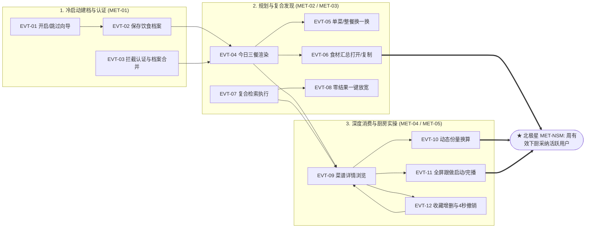

# 07-1. 核心业务数据指标体系与转化漏斗（`MET-*`）

本文档严格遵循元规范 [03-authoring-templates.md 第 2.7.1 节](../../meta/03-authoring-templates.md#tpl-metric-funnel) 与 [02-id-and-traceability.md 铁律 5](../../meta/02-id-and-traceability.md#rule-5)，定义【菜谱 Cookbook】的**北极星指标**、**五大功能漏斗主公式与护栏口径**及**全链路事件跃迁拓扑**。所有公式统一采用“**自然语言业务口径 + 关联事件锚点链接**”可读写法，确保无需翻查埋点表即可直读业务计算逻辑。

---

## 1. 北极星指标定义表（North Star Metric）

| 指标 ID | 指标名称 | 统计粒度与窗口 | 精确计算口径（自然语言描述 + 底层 `EVT-*` 过滤条件） | 核心价值论证与反虚荣说明 |
| :--- | :--- | :--- | :--- | :--- |
| **MET-NSM** | **周有效下厨采纳活跃用户数** （Weekly Active Cooks, WAC） | 去重用户/设备数（已登录按账号 ID，游客按设备 ID 归一）· 自然周（周一 `00:00` ~ 周日 `23:59`） | 自然周内至少触发以下任一**深度备餐/实操行为** `>= 1` 次的去重主体数： 1. 启动全屏跟做（[EVT-11 全屏跟做启动/完播](./event-dictionary.md#evt-11)，限定 `stage == 'start'`） 2. 手动折算菜谱份量（[EVT-10 手动折算份量](./event-dictionary.md#evt-10)） 3. 复制导出今日采购清单（[EVT-06 使用今日食材汇总](./event-dictionary.md#evt-06)，限定 `action == 'copy'`） | 摒弃纯页面浏览 UV 等虚荣流量口径——唯有发生份量换算、采购清单导出或启动厨房跟做，才证明产品真正帮用户完成了从“纠结吃什么”到“实际动手下厨”的核心价值交付。 |

---

## 2. 核心业务漏斗与过程诊断指标表（`MET-01 ~ MET-05`）

| 指标 ID | 归属功能 | 指标名称 | 统计粒度与窗口 | 精确计算公式（自然语言分子 ÷ 自然语言分母，附事件链接） | 异常阈值与业务归因诊断 |
| :--- | :--- | :--- | :--- | :--- | :--- |
| **MET-01** | [FEAT-01 渐进建档与认证一体化](../01-vision-and-scope.md#feat-01) | **偏好建档完成率与拦截认证接续率** | 去重设备数 / 触发次数 · 自然日/周 | • **向导建档完成率** = 完成向导保存档案的去重设备数（[EVT-02 保存饮食档案](./event-dictionary.md#evt-02)，限定 `source == 'wizard'`）÷ 进入向导首屏的去重设备数（[EVT-01 向导进出](./event-dictionary.md#evt-01)，限定 `action == 'enter'`） • **拦截登录接续率** = 携带挂起动作完成登录的次数（[EVT-03 完成快捷认证](./event-dictionary.md#evt-03)，限定 `has_pending_action == true`）÷ 游客触发受限动作唤起认证框总次数 | • 若向导建档完成率 `< 65%`，需按跳过向导事件上报的步骤号（`step_no`）定位流失最高的步骤并精简选项 • 若拦截登录接续率 `< 45%`，需检查弹窗接续提示文案或验证码下发延迟 |
| **MET-02** | [FEAT-02 智能三餐配餐](../01-vision-and-scope.md#feat-02) [FEAT-03 跨菜食材合并](../01-vision-and-scope.md#feat-03) | **今日三餐推荐采纳率与换菜健康度** | 去重会话数（Session）· 自然日 | • **主推荐采纳率** = 从今日菜谱点进详情（[EVT-09 菜谱详情浏览](./event-dictionary.md#evt-09)，限定 `entry_source == 'daily_plan'`）或打开食材汇总抽屉（[EVT-06 使用今日食材汇总](./event-dictionary.md#evt-06)，限定 `action == 'open'`）的去重会话数 ÷ 今日三餐完成渲染的去重会话数（[EVT-04 今日三餐渲染](./event-dictionary.md#evt-04)） • **护栏：单会话平均换菜频次** = 点击单菜或整餐换一换总次数（[EVT-05 菜品换一换](./event-dictionary.md#evt-05)）÷ 今日三餐渲染去重会话数（`EVT-04`） | 若单会话换菜频次 `> 4.0` 次且主推荐采纳率 `< 30%`，表明推荐打分与用户风味偏好错位，或特定忌口组合下候选菜谱池过窄导致重复轮换 |
| **MET-03** | [FEAT-04 多维复合检索](../01-vision-and-scope.md#feat-04) | **复合检索有效点击率与零结果挽回率** | 检索请求次数 / 去重会话 · 自然日/周 | • **检索点击转化率** = 检索后点进菜谱详情的会话数（[EVT-09 菜谱详情浏览](./event-dictionary.md#evt-09)，限定 `entry_source == 'search'`）÷ 执行复合检索的会话数（[EVT-07 执行复合检索](./event-dictionary.md#evt-07)） • **护栏：检索零结果率** = 命中数为 `0` 的检索次数（`EVT-07` 且 `result_count == 0`）÷ 执行检索总次数（`EVT-07`） • **放宽挽回率** = 点击一键放宽并恢复召回结果次数（[EVT-08 点击零结果放宽](./event-dictionary.md#evt-08)，限定 `recovered_count > 0`）÷ 检索零结果总次数 | 若零结果率 `> 10%`，按搜索词与筛选项组合聚类排查 [DOM-RCP-StandardIngredient 标准食材库](../02-domain-model/recipe-catalog/entities.md#dom-rcp-standardingredient) 同义词缺失或长尾快手菜供给盲区 |
| **MET-04** | [FEAT-05 详情双图表与动态换算](../01-vision-and-scope.md#feat-05) [FEAT-06 屏幕常亮分步跟做](../01-vision-and-scope.md#feat-06) | **厨房跟做启动率与完播率** | 事件次数 · 自然周（支持按视口 `viewport_shell` 分端拆解） | • **跟做启动率** = 点击开始跟做次数（[EVT-11 全屏跟做启动/完播](./event-dictionary.md#evt-11)，限定 `stage == 'start'`）÷ 菜谱详情浏览总次数（[EVT-09 菜谱详情浏览](./event-dictionary.md#evt-09)） • **跟做完播率** = 点击最后一步完成出锅次数（`EVT-11` 且 `stage == 'complete'`）÷ 点击开始跟做次数（`EVT-11` 且 `stage == 'start'`） | 对比平板（`tablet`）与手机（`mobile`）端的完播率差异；若跟做完播率 `< 50%`，需排查步骤切分是否过碎或倒计时交互阻碍翻页 |
| **MET-05** | [FEAT-07 轻量收藏夹与撤销保护](../01-vision-and-scope.md#feat-07) | **详情净收藏率与私房收藏复访率** | 去重用户数 · 自然周 | • **详情净收藏率** = 净新增收藏次数（[EVT-12 收藏增删与撤销](./event-dictionary.md#evt-12) 中 `add` 次数 − `remove` 次数 + `undo_restore` 次数）÷ 菜谱详情浏览总次数（[EVT-09 菜谱详情浏览](./event-dictionary.md#evt-09)） • **收藏周复访点开率** = 从收藏夹点进菜谱详情的去重登录用户数（`EVT-09` 且 `entry_source == 'favorites'`）÷ 当周总活跃登录用户数 | 若净收藏率高但收藏周复访点开率 `< 15%`，说明收藏夹沦为“只收不看吃灰夹”，需强化检索“仅看收藏”联动入口与角色快筛体验 |

---

## 3. 全链路下厨转化事件跃迁拓扑图

