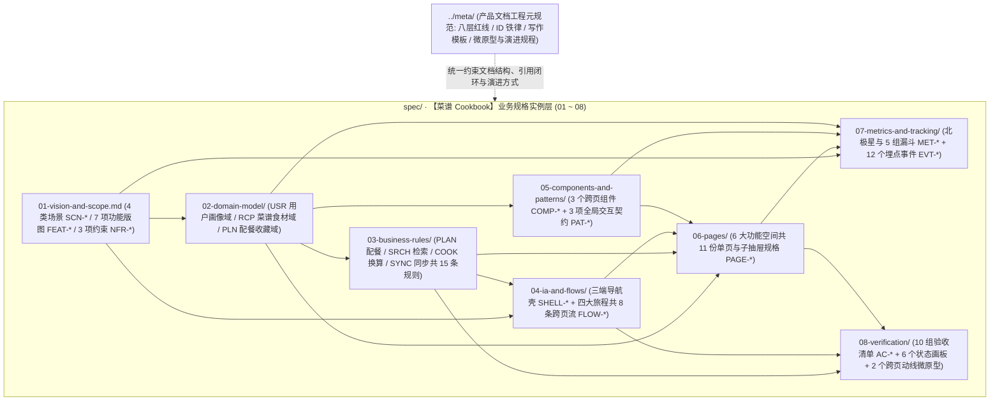

# 【菜谱 Cookbook】产品规格库（Product Specification Instance）

本目录（`spec/`）是【菜谱】应用的**产品单一事实源（Single Source of Truth）**，严格遵循上级 **[产品文档工程元规范（`../meta/`）](../meta/README.md)** 构建与持续演进，面向首次接触本项目的产品、设计（`../Design/`）、研发（`../Code/`）与测试协作者提供**完全自包含、零背景门槛、双向可追溯**的产品规格契约。

---

## 零、3 分钟读懂产品背景与本项目编码约定

### 0.1 这是什么产品？
【菜谱 Cookbook】是一款面向个人与家庭日常下厨场景的**个性化智能配餐与沉浸式跟做应用**，支持**手机端**（`<768px`）、**平板厨房横屏端**（`768~1023px`）、**桌面 Web 端**（`>=1024px`）三端响应式自适应，核心围绕四大业务能力形成闭环：
1. **五维个人饮食建档与免登录引导**：支持“先逛后登”，渐进采集用户的*使用目的、用餐人数结构（如独居 1 人食、三口之家）、口味与辣度上限、过敏忌口、厨艺耗时与厨具、健康偏好*，并在登录老账号时妥善裁决合并本地草稿与云端旧档案。
2. **千人千面“今日菜谱”与备菜汇总**：依据个人饮食档案自动过滤忌口、匹配人数对应的套餐结构（如 1 人“一碗端”快手餐 vs 三口之家“两菜一汤”），支持单菜/整餐不重样“换一换”，并一键合并当日跨菜谱所需的全部食材清单。
3. **多维复合“菜谱检索”与轻量收藏**：支持菜名/食材同义词联想（如搜“番茄”自动召回“西红柿”）、多食材“智能匹配度排序 vs 严格全部包含”双模式切换，叠加菜系、辣度、耗时、难度、健康标签及“仅看我的收藏”复合过滤；提供带 4 秒防误删撤销保护的单层收藏夹。
4. **动态换算“菜谱详情”与防熄屏分步跟做**：提供带章节时间戳与小窗悬浮的视频、单人份营养构成环形图、烹饪火候时间轴图；切换用餐人数（`1~8` 人）时，**食材清单与步骤正文内嵌的调料/食材用量同步人性化取整折算**（杜绝“0.7 个鸡蛋”等反直觉小数）；支持一键进入全屏常亮大字号分步跟做与跨步骤悬浮倒计时。

### 0.2 本项目命名空间注册与 ID 前缀速查表
根据元规范 [02-id-and-traceability.md](../meta/02-id-and-traceability.md) 要求，本库采用**活文档基线 + 正交八层（`01`~`08`）+ 唯一锚点引用**组织（每类信息只在专属目录定义一次，跨层通过链接引用，产品演进时原地更新当前生效基线）。本项目注册的语义化 ID 前缀与业务命名空间如下：

| 层级 | ID 前缀格式 | 本项目注册的业务命名空间缩写 | 含义说明 |
| :--- | :--- | :--- | :--- |
| **`01` 愿景范围** | `SCN-*` / `FEAT-*` / `NFR-*` | 全局统一序号 | **用户场景** / **产品功能版图项** / **全局非功能约束** |
| **`02` 领域模型** | `TERM-*` / `DOM-*` / `ENUM-*` | `USR`（用户与饮食画像域）· `RCP`（菜谱与标准食材域）· `PLN`（膳食规划与收藏域） | **业务术语** / **静态实体表结构** / **全局标准枚举值字典** |
| **`03` 业务规则** | `RULE-*` | `PLAN`（智能配餐与换菜）· `SRCH`（复合检索与匹配）· `COOK`（分量换算与下厨）· `SYNC`（身份转化与同步） | **跨页面/跨数据域的后台计算、过滤、折算与降级兜底规则** |
| **`04` 架构流程** | `SHELL-*` / `FLOW-*` | 视口：`Mobile` / `Tablet` / `Desktop` 旅程：`AUTH`（引导认证）· `PLAN`（配餐汇总）· `DISC`（检索收藏）· `COOK`（详情跟做） | **三端响应式导航容器壳** / **跨页面端到端业务流转图** |
| **`05` 公共资产** | `COMP-*` / `PAT-*` | 全局复用大驼峰语义名 | **多页面复用的公共 UI 组件** / **全局通用交互反馈状态机** |
| **`06` 页面规格** | `PAGE-*` | `COMM`（引导认证）· `PLAN`（今日菜谱）· `SRCH`（找菜谱）· `FAV`（收藏夹）· `COOK`（详情跟做）· `PROF`（个人中心） | **单个独立页面或高复杂度抽屉/全屏子视图**的五段式规格书 |
| **`07` 数据埋点** | `MET-*` / `EVT-*` | `MET-NSM`（北极星指标）及两位序号 | **业务转化漏斗指标公式** / **关键业务埋点事件及属性字典** |
| **`08` 验收原型** | `AC-*` / `PROTO-*` | 对应业务能力或页面空间缩写 | **结构化验收测试用例** / **浏览器可交互 HTML 微原型** |

---

## 一、Cookbook 规格体系架构与依赖脉络

> **上下游依赖脉络说明**（若编辑器未安装 Mermaid 预览扩展，可直接参考以下推导关系）：
> 1. **自顶向下逐层收敛**：由 `01 愿景与范围` 划定场景与产品能力边界 → 抽象出 `02 三大子域静态数据字典` → 在数据之上建立 `03 四大业务计算规则簇` 与 `05 跨页公共组件/交互契约` → 串联成 `04 三端导航壳与跨页任务流` → 最终在 `06 单页规格书` 完成三端页面组装。
> 2. **横向度量与交互验证**：`07 指标与埋点` 采集 `05/06` 中的关键交互事件以量化评估 `01` 的业务目标；`08 验收与微原型` 将 `03` 的规则边界、`04` 的跨页状态传递与 `06` 的全部页面状态转化为可勾选的验收用例与浏览器可点击体验的 HTML 原型。

---

## 二、八层目录详解与全量业务文档导航索引

### 2.1 各层职责定位与本项目拆分总览

| 层级 | 本层总入口 | 本层回答的核心业务问题 | 本项目内部文件组织结构 | 状态 |
| :--- | :--- | :--- | :--- | :--- |
| **01 愿景与范围** | [01-vision-and-scope.md](./01-vision-and-scope.md) | 为什么要做【菜谱】？服务哪几类做饭人群场景？当前产品功能版图包含什么、明确不涉足哪些非目标边界？ | 宏观统领，单文件承载。 | ✅ 已定版 |
| **02 领域模型** | [02-domain-model/_index.md](./02-domain-model/_index.md) | 系统有哪些静态业务概念？用户档案、菜谱、三餐单、收藏记录各有哪些字段与标准枚举值？ | 按数据归属边界拆为 **3 个子目录**（`user-profile/`、`recipe-catalog/`、`meal-and-collection/`），每域内固定拆为 `terms.md`、`entities.md`、`enums.md`。 | ✅ 已定版 |
| **03 业务规则** | [03-business-rules/_index.md](./03-business-rules/_index.md) | 三餐怎么过滤忌口并按人数配菜？多食材怎么匹配？切人数时食材怎么人性化取整？游客登录怎么合并旧档案？ | 按核心业务决策能力拆分为 **4 份专题规则文档**（共 15 条五要素规则卡）。 | ✅ 已定版 |
| **04 架构与流程** | [ia-and-shell.md](./04-ia-and-flows/ia-and-shell.md) [flows/_index.md](./04-ia-and-flows/flows/_index.md) | 手机/平板/Web 三端导航栏怎么布局？用户完成建档、配餐、找菜、跟做要跨哪几个页面流转与同步状态？ | 1 份三端响应式容器壳文档 + `flows/` 下按用户旅程拆分的 **4 份跨页流程图文档**（共 8 条流程）。 | ✅ 已定版 |
| **05 组件与交互** | [05-components-and-patterns/_index.md](./05-components-and-patterns/_index.md) | 菜谱卡片、人数步进器、联想搜索框在各处有哪些变体？未登录拦截自动接续和 4 秒撤销条怎么统一运作？ | 按“**可视复用组件**”与“**跨页交互契约**”拆分为 `shared-components.md` 与 `interaction-patterns.md`。 | ✅ 已定版 |
| **06 页面规格** | [06-pages/_index.md](./06-pages/_index.md) | 每个具体页面和抽屉在三端怎么排布区块？绑定哪些字段？有哪几种正常/空/异常状态？点按钮触发什么规则与埋点？ | 按全站 **6 大功能空间**建子目录，主页面与专属高复杂度抽屉/全屏子视图平级拆分为 **11 份五段式规格书**。 | ✅ 已定版 |
| **07 指标与埋点** | [metrics-funnel.md](./07-metrics-and-tracking/metrics-funnel.md) [event-dictionary.md](./07-metrics-and-tracking/event-dictionary.md) | 用什么北极星指标和转化漏斗衡量下厨价值？需要在哪些交互节点采集哪些业务事件与属性？ | 按“**业务指标公式**”与“**底层事件采集字典**”拆分为上下咬合的 2 份文档。 | ✅ 已定版 |
| **08 验收与原型** | [acceptance-criteria.md](./08-verification/acceptance-criteria.md) [prototypes/index.html](./08-verification/prototypes/index.html) | 研发提测按什么清单验收？如何在写代码前直接在浏览器里一键切换体验所有正常态、异常态与跨页动线？ | 采用“**1 份验收清单 + 6 个单页多状态交互画板 + 2 个跨页状态传递微原型**”组织，零前置步骤一键直达任意边界状态。 | ✅ 已定版 |

---

### 2.2 全量文档与可交互微原型清单（含直达链接）

- **`01` 产品愿景与功能范围**
  - [01-vision-and-scope.md](./01-vision-and-scope.md)：定义日常做饭四大痛点、4 类目标人群场景（独居快手一碗端 `SCN-01`、双人餐与收藏沉淀 `SCN-02`、三口之家均衡配餐 `SCN-03`、厨房实操防翻车跟做 `SCN-04`）、7 项核心功能版图（`FEAT-01~07`）与非目标排除边界（社区 UGC、生鲜配送、硬件外设），以及 3 项全局非功能约束（`NFR-01~03`）。

- **`02` 领域模型与数据字典**（总索引与全局 ER 图：[02-domain-model/_index.md](./02-domain-model/_index.md)）
  - **用户与饮食画像子域 `user-profile/`**：账号 `DOM-USR-Account` 与五维饮食档案 `DOM-USR-DietaryProfile`，含使用目的、家庭人数结构、口味偏好、厨艺水平、耗时预算、现有厨具、健康诉求、特殊忌口 8 套枚举 —— [术语 terms.md](./02-domain-model/user-profile/terms.md) · [实体 entities.md](./02-domain-model/user-profile/entities.md) · [枚举 enums.md](./02-domain-model/user-profile/enums.md)
  - **菜谱与标准食材子域 `recipe-catalog/`**：标准食材同义词库 `DOM-RCP-StandardIngredient`、菜谱聚合根 `DOM-RCP-Recipe`、食材明细、带动态占位符的步骤表、单人份营养环形图与火候时间轴图，含菜系、餐次、角色、辣度、难度、换算模式、火候 7 套枚举 —— [术语 terms.md](./02-domain-model/recipe-catalog/terms.md) · [实体 entities.md](./02-domain-model/recipe-catalog/entities.md) · [枚举 enums.md](./02-domain-model/recipe-catalog/enums.md)
  - **膳食规划与收藏子域 `meal-and-collection/`**：每日三餐推荐单 `DOM-PLN-DailyMealPlan`、当日食材合并汇总项 `DOM-PLN-IngredientSummaryItem`、轻量收藏记录 `DOM-PLN-FavoriteRecord`，含多食材匹配模式、排序方式、备菜分类 3 套枚举 —— [术语 terms.md](./02-domain-model/meal-and-collection/terms.md) · [实体 entities.md](./02-domain-model/meal-and-collection/entities.md) · [枚举 enums.md](./02-domain-model/meal-and-collection/enums.md)

- **`03` 全局业务规则库**（总索引：[03-business-rules/_index.md](./03-business-rules/_index.md)，共 15 条核心规则）
  - [meal-recommendation.md](./03-business-rules/meal-recommendation.md)（智能配餐与换菜 `RULE-PLAN-01~05`）：过敏/辣度/厨具硬过滤一票否决、按用餐人数决定餐次菜品组合矩阵、个性化推荐命中理由生成、单菜/整餐“换一换”同餐主材互斥与防重、当日跨菜谱同类食材合并算法。
  - [search-and-matching.md](./03-business-rules/search-and-matching.md)（复合检索与匹配 `RULE-SRCH-01~04`）：菜名与标准食材同义词召回、多食材“智能匹配度排序 vs 严格全部包含”切换算法、主动搜忌口食材时的保留与显著预警、复合筛选零结果时的阶梯放宽恢复策略。
  - [portion-and-cooking.md](./03-business-rules/portion-and-cooking.md)（分量换算与下厨 `RULE-COOK-01~03`）：进入详情页时目标用餐人数的默认继承优先级、按食材物理属性（自然计数整颗/称重食材/微量调料/固定不缩放）的人性化取整公式、顶部人数切换驱动食材表与步骤正文内嵌数值实时同步。
  - [identity-and-sync.md](./03-business-rules/identity-and-sync.md)（身份转化与同步 `RULE-SYNC-01~03`）：游客本地偏好草稿持久化与默认兜底、登录老账号检出云端旧档案与本地草稿不一致时的双方案裁决合并、修改饮食档案后对当日已生成菜单的温和确认刷新保护。

- **`04` 信息架构与端到端业务流程**
  - [ia-and-shell.md](./04-ia-and-flows/ia-and-shell.md)：全站页面层级拓扑图，以及手机底部四栏 Tab（`SHELL-Mobile`）、平板横屏左导航右双栏（`SHELL-Tablet`）、桌面端左侧栏+常驻筛选双栏（`SHELL-Desktop`）三端容器壳规范。
  - **跨页业务流程库**（总索引与跨页状态同步总表：[04-ia-and-flows/flows/_index.md](./04-ia-and-flows/flows/_index.md)）
    - [auth-and-onboarding.md](./04-ia-and-flows/flows/auth-and-onboarding.md)：首次冷启动渐进偏好建档流（`FLOW-AUTH-01`）、游客受限操作拦截登录→档案冲突裁决→自动完成原操作流（`FLOW-AUTH-02`）。
    - [meal-planning.md](./04-ia-and-flows/flows/meal-planning.md)：今日三餐查看、换菜与食材汇总核对闭环（`FLOW-PLAN-01`）、个人饮食档案修改后返回首页温和确认重算流（`FLOW-PLAN-02`）。
    - [search-and-collection.md](./04-ia-and-flows/flows/search-and-collection.md)：多维复合检索与零结果阶梯放宽流（`FLOW-DISC-01`）、菜谱收藏沉淀与 4 秒防误删撤销流（`FLOW-DISC-02`）。
    - [detail-and-cooking.md](./04-ia-and-flows/flows/detail-and-cooking.md)：菜谱详情多媒体阅读、章节跳播与动态调人数流（`FLOW-COOK-01`）、全屏常亮分步跟做与后台悬浮计时流（`FLOW-COOK-02`）。

- **`05` 公共业务组件与全局交互契约**（总索引：[05-components-and-patterns/_index.md](./05-components-and-patterns/_index.md)）
  - [shared-components.md](./05-components-and-patterns/shared-components.md)：跨页复用菜谱摘要卡片 `COMP-RecipeCard`（含今日推荐/搜索命中/收藏夹 3 种变体）、用餐人数调节器 `COMP-ServingsStepper`、同义词联想搜索框 `COMP-SearchBar`。
  - [interaction-patterns.md](./05-components-and-patterns/interaction-patterns.md)：未登录受限操作挂起与登录后自动执行状态机 `PAT-AuthResume`、破坏性移除底部 4 秒可撤销提示条 `PAT-UndoSnackbar`、全局加载骨架屏/空数据引导/弱网异常契约 `PAT-ViewStates`。

- **`06` 单页与子视图规格书**（总注册表：[06-pages/_index.md](./06-pages/_index.md)，按 6 大功能空间组织共 11 份五段式规格书）
  1. **引导与认证空间 `common-and-onboarding/`**：[首次 5 步偏好引导向导 `PAGE-COMM-01`](./06-pages/common-and-onboarding/onboarding-wizard.md) · [快捷验证码登录与档案冲突裁决弹窗 `PAGE-COMM-02`](./06-pages/common-and-onboarding/auth-modal.md)
  2. **今日菜谱空间 `daily-plan/`**：[今日三餐推荐主页 `PAGE-PLAN-01`](./06-pages/daily-plan/daily-meal-plan.md) · [今日食材汇总核对抽屉 `PAGE-PLAN-02`](./06-pages/daily-plan/ingredient-summary-drawer.md)
  3. **找菜谱检索空间 `recipe-discovery/`**：[找菜谱检索主页 `PAGE-SRCH-01`](./06-pages/recipe-discovery/recipe-search.md) · [多维复合筛选抽屉/常驻侧栏 `PAGE-SRCH-02`](./06-pages/recipe-discovery/complex-filter-panel.md)
  4. **收藏夹空间 `favorites/`**：[我的收藏夹主页 `PAGE-FAV-01`](./06-pages/favorites/favorites-list.md)
  5. **菜谱详情与跟做空间 `recipe-consumption/`**：[多媒体菜谱详情页 `PAGE-COOK-01`](./06-pages/recipe-consumption/recipe-detail.md) · [全屏防熄屏分步跟做视图 `PAGE-COOK-02`](./06-pages/recipe-consumption/cooking-focus-mode.md)
  6. **个人中心与饮食档案空间 `user-profile/`**：[我的个人中心主页 `PAGE-PROF-01`](./06-pages/user-profile/profile-home.md) · [我的饮食档案编辑页 `PAGE-PROF-02`](./06-pages/user-profile/dietary-archive-editor.md)

- **`07` 核心数据指标与埋点字典**
  - [metrics-funnel.md](./07-metrics-and-tracking/metrics-funnel.md)：北极星指标（每周有效下厨转化活跃用户数 `MET-NSM`）及偏好建档率、三餐推荐采纳率、复杂检索有效点击与零结果率、跟做完播率、收藏回访率 5 组漏斗公式（`MET-01~05`）。
  - [event-dictionary.md](./07-metrics-and-tracking/event-dictionary.md)：支撑全部指标计算的 12 个关键业务事件定义（`EVT-01~12`），明确触发载体、时机与必传业务属性。

- **`08` 验收标准与可交互 HTML 微原型**
  - [acceptance-criteria.md](./08-verification/acceptance-criteria.md)：覆盖配餐硬过滤、多食材检索放宽、自然计数食材取整、双端档案合并等边界的 10 组 `Given-When-Then` 必测验收用例（`AC-*`）。
  - [prototypes/index.html](./08-verification/prototypes/index.html)（**浏览器直接打开即可交互体验的微原型总控台**）：
    - **6 个功能空间多状态交互画板**：[引导与认证](./08-verification/prototypes/pages/common-onboarding.html) · [今日菜谱与汇总](./08-verification/prototypes/pages/daily-plan.html) · [找菜谱复合检索](./08-verification/prototypes/pages/recipe-discovery.html) · [收藏夹](./08-verification/prototypes/pages/favorites.html) · [菜谱详情与全屏跟做](./08-verification/prototypes/pages/recipe-consumption.html) · [个人中心与饮食档案](./08-verification/prototypes/pages/user-profile.html)（顶栏均支持切换手机/平板/Web 视口，以及一键直达页面规格第 4 节定义的全部状态分支）。
    - **2 个跨页面状态传递微原型**：[游客点收藏触发登录→双端档案冲突裁决→自动完成收藏](./08-verification/prototypes/flows/flow-auth-and-merge.html) · [修改个人饮食档案→切回今日菜谱温和确认重算](./08-verification/prototypes/flows/flow-profile-to-plan-sync.html)。

---

## 三、不同角色的阅读路径与落地指南

无需从头到尾通读全部文件，请根据你的协作角色按最短路径切入：

### 1. 初次了解项目的新成员 / 产品与业务评审方
> **阅读目标**：在 20~30 分钟内搞清产品业务边界、核心体验亮点、异常兜底逻辑与商业衡量口径。
1. **看定位与能力版图**：阅读 [01-vision-and-scope.md](./01-vision-and-scope.md)，掌握四大目标场景（`SCN-01~04`）与当前产品功能版图及非目标边界（`FEAT-01~07`）。
2. **直观把玩可交互微原型**：用浏览器打开 [08-verification/prototypes/index.html](./08-verification/prototypes/index.html)，先体验底部 **2 个跨页动线微原型**感受“先逛后登自动接续”与“改档案温和刷新三餐”，再点进 **6 个功能空间画板**用顶栏状态按钮检视各功能细节（如详情页加减人数实时联动步骤文案、分步跟做计时器）。
3. **核对业务链路与北极星指标**：查阅 [04-ia-and-flows/flows/_index.md](./04-ia-and-flows/flows/_index.md) 了解 8 条端到端业务流，阅读 [07-metrics-and-tracking/metrics-funnel.md](./07-metrics-and-tracking/metrics-funnel.md) 对齐上线后的数据评估口径。

### 2. UI / UX 设计师（承接下游 `../../Design/` 目录）
> **阅读目标**：输出多端响应式栅格规范、公共 Design System 组件库，以及覆盖全部边界状态的高保真视觉稿。
1. **确立三端响应式导航框架**：精读 [04-ia-and-flows/ia-and-shell.md](./04-ia-and-flows/ia-and-shell.md)，掌握手机（`<768px` 底部导航）、平板（`768~1023px` 厨房横屏双栏）、桌面（`>=1024px` 左侧导航+常驻筛选面板）的断点与抽屉变形规则。
2. **先行沉淀公共组件与全局交互态**：阅读 [shared-components.md](./05-components-and-patterns/shared-components.md) 与 [interaction-patterns.md](./05-components-and-patterns/interaction-patterns.md)，优先设计菜谱卡片（3 种业务变体）、人数步进器、搜索联想框，以及全站统一的骨架屏、空状态、4 秒底部撤销条与认证弹窗。
3. **对照单页规格与状态画板逐页出图**：从 [06-pages/_index.md](./06-pages/_index.md) 进入全部 11 份单页规格书，严格对照每份文档的**第 2 节**（三端布局）、**第 3 节**（区块字段绑定）、**第 4 节**（页面状态枚举 S1~S5）及配套的 `prototypes/pages/*.html` 线框画板出图，确保游客态、忌口预警态、零结果放宽态、弱网降级态无一遗漏（核对标准标签文案直接点击文档中的 `ENUM-*` 链接查阅）。

### 3. 后端与算法工程师（承接下游 `../../Code/` 服务端）
> **阅读目标**：设计数据库表结构、定义枚举常量与 API 接口契约，实现推荐配餐、同义检索与数据合并服务。
1. **数据库建模与接口 Schema 定义**：打开 [02-domain-model/_index.md](./02-domain-model/_index.md) 查看全局实体关系 ER 图，并以三大子域下的 `entities.md` 和 `enums.md` 作为建表与接口 DTO 的唯一事实源。
2. **核心推荐、检索与同步服务实现**：逐条对照 [03-business-rules/_index.md](./03-business-rules/_index.md) 下属的 4 份规则文档，落地三餐硬过滤与人数配餐矩阵（[meal-recommendation.md](./03-business-rules/meal-recommendation.md)）、标准食材同义召回与多食材双模检索及零结果阶梯放宽（[search-and-matching.md](./03-business-rules/search-and-matching.md)）、老账号双端档案冲突合并接口（[identity-and-sync.md](./03-business-rules/identity-and-sync.md)）。
3. **接口粒度与埋点核对**：结合 [06-pages/_index.md](./06-pages/_index.md) 各页第 3、5 节确认读写接口组装需求，并参考 [event-dictionary.md](./07-metrics-and-tracking/event-dictionary.md) 校验关键业务事件属性。

### 4. 前端与客户端工程师（承接下游 `../../Code/` 客户端）
> **阅读目标**：搭建三端自适应容器壳、封装复用组件与本地草稿缓存、开发全部页面状态机与端侧实时分量换算、接入埋点。
1. **搭建路由壳与全局拦截机制**：按 [ia-and-shell.md](./04-ia-and-flows/ia-and-shell.md) 搭建三端响应式容器壳；按 [interaction-patterns.md](./05-components-and-patterns/interaction-patterns.md) 封装“未登录受限动作挂起并在认证后自动重放”拦截器（`PAT-AuthResume`）、4 秒可撤销提示条（`PAT-UndoSnackbar`）及游客本地偏好草稿缓存（[RULE-SYNC-01](./03-business-rules/identity-and-sync.md#rule-sync-01)）。
2. **逐空间开发页面视图与端侧换算引擎**：按 [06-pages/_index.md](./06-pages/_index.md) 实现 11 个视图的数据绑定、第 4 节状态机切换及第 5 节交互事件；开发详情页与跟做页时，严格依据 [portion-and-cooking.md](./03-business-rules/portion-and-cooking.md)（`RULE-COOK-01~03`）实现食材人性化取整与步骤富文本占位符实时联动，随时对照 [prototypes/index.html](./08-verification/prototypes/index.html) 校验交互细节。
3. **埋点上报与提测自检**：按各单页规格第 5 节绑定的 `EVT-*` 链接查阅 [event-dictionary.md](./07-metrics-and-tracking/event-dictionary.md) 完成埋点上报，提测前对照 [acceptance-criteria.md](./08-verification/acceptance-criteria.md) 逐条自测。

### 5. 测试 / QA 工程师
> **阅读目标**：制定测试计划、构造极端边界测试数据集、执行多端功能与埋点端到端准出验收。
1. **梳理跨页主链路与同步检查点**：阅读 [04-ia-and-flows/flows/_index.md](./04-ia-and-flows/flows/_index.md) 中的跨页状态同步总表及 8 条流程图，锁定跨模块联动测试点。
2. **基于业务规则构造边界与降级用例**：对照 [03-business-rules/_index.md](./03-business-rules/_index.md) 中全部 15 条规则的“判定矩阵”与“边界降级兜底（Fallback）”，构造特殊测试数据（过敏原菜谱、冷门组合零结果、自然计数食材非整倍缩放、双端档案冲突账号）。
3. **执行准出验收与全状态比对**：以 [acceptance-criteria.md](./08-verification/acceptance-criteria.md) 作为准出底线，并对照 [prototypes/index.html](./08-verification/prototypes/index.html) 各画板顶栏列出的全部界面状态与 [event-dictionary.md](./07-metrics-and-tracking/event-dictionary.md) 核验覆盖率。

### 6. 后续演进与维护规范的产品经理
> **阅读目标**：随产品迭代原地拓展功能、修改规则或调整字段，保持全库作为最新生效基线演进。
- 动笔前请先阅读元规范 **[05-lifecycle-and-governance.md](../meta/05-lifecycle-and-governance.md)** 与 **[03-authoring-templates.md](../meta/03-authoring-templates.md)**，严格按原地演进传播路径更新对应层级，提交前逐项对照元规范中的 6 项质量门禁（DoD）完成自检。
